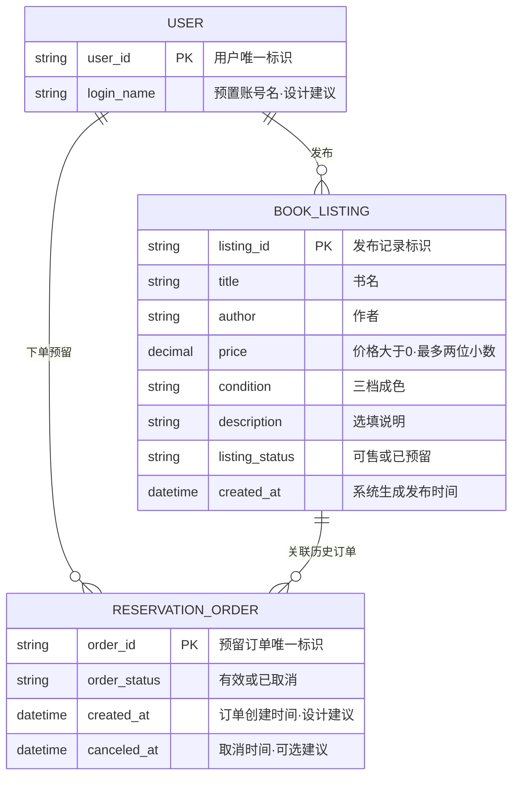

# 实验二｜概念 ER 模型（v0.1）

> 本阶段仅为**概念设计**：要求对应教师《数据库设计实验指导书》v1.6 第1页“实体、关键属性、标识、联系基数及可选性”。实验一正式需求基线：[v0.5.6 固定提交](https://github.com/LianOldMan/se-software243-group21/commit/ef48f32aa9da25b12a6b279a58e37d9d947131f5)。主责建议：练悦（A）；本模型尚待 B/C 实际检查，不能把“数据库已设计并验证”写入报告。

## 一、概念 ER 图

下面的 **Mermaid ER 图**在 GitHub 中可直接预览；可编辑的 draw.io 源文件为 [`ER_concept_v0.1.drawio`](ER_concept_v0.1.drawio)。本图与后续的“数据库表间关系图”不是同一项成果。

> 图中 `string`、`decimal`、`datetime` 只是 Mermaid 绘图语法里的**概念性属性类别**，**尚不是已决定的数据库 SQL 类型与长度**；实际类型、主外键与约束实现要等到下一步逻辑设计。图中 PK 标签表示**概念实体的唯一标识**，不是已创建数据库主键。

## 二、实体标识与参与可选性

| 实体 | 标识 | 属性是否必须 | 设计边界 |
|---|---|---|---|
| User | `user_id` | 预置账号必须能被唯一定位；`login_name`为建议 | 不把“买家、卖家”拆成两个互斥用户实体；一个账号可同时扮演二者 |
| BookListing | `listing_id` | 书名、作者、价格、成色、状态、系统发布时间必须明确；说明可为空 | 一条发布对应一本实物书，不按相同书名/作者自动合并 |
| ReservationOrder | `order_id` | 必须关联一位买家、一本书、有当前订单状态；创建/取消时间是建议属性 | 一笔订单只定位一次预留，已取消仍保存其历史，旧订单与新订单 ID 不相同 |

| 联系 | 左端 → 右端 | 右端 → 左端 | 为什么有“0” |
|---|---|---|---|
| 用户**发布**书籍 | User 1 → BookListing 0..N | 每本 BookListing → 1 位发布者 | 预置用户可从未发布过书籍 |
| 用户**下单**预留 | User 1 → ReservationOrder 0..N | 每笔订单 → 1 位买家 | 用户可从未下过单 |
| 书籍**关联历史订单** | BookListing 1 → ReservationOrder 0..N | 每笔订单 → 1 本书籍 | 一本刚发布的书可能尚无订单 |

图中“0..N”指**子记录在该关系中的数量**，不等于允许一条书籍同时有多笔有效订单。**最多一条有效订单**为独立的业务约束。

## 三、跨实体不变量与后续实现责任

1. **唯一有效预留**：对于任一书籍发布记录，关联订单中状态为“有效”的数量必须 `<= 1`（FR-05/06、B-04）。
2. **状态相符**：有且仅有一笔有效订单时，书籍状态为“已预留”；没有有效订单时，状态为“可售”。如果逻辑设计决定同时存两处状态，必须说明一致性维护责任（NFR-02）。
3. **禁止自购**：任何有效预留订单的买家都不能是其关联书籍的发布者（R-04）。
4. **取消归属与历史保护**：只能由原订单买家取消；取消后原订单记录保留，旧订单请求不得释放后来新订单 O2 的书籍（FR-07/08、AC-05-3/4/5）。
5. **预留/取消原子性**：概念 ER 只能描述这些要求，不能证明系统自动满足。下一步需设计**应用逻辑、事务或数据库约束的责任边界**；外键只能保证引用存在，不能单独保证以上所有条件。
6. **发布校验**：正数价格且最多两位小数、固定成色、必填项、系统生成发布时间，下一步依据数据字典与业务校验策略分别落实。

## 四、设计范围与待确认问题

- 本图**不新增**支付记录、运输信息、交易完成、评价、管理员、独立搜索记录、账号注册等实体；这些均被实验一排除。
- `login_name`、订单 `created_at`/`canceled_at` 是**本组后续可以采纳或调整的设计建议**，而非 v0.5.6 强制要求展示的字段。
- B-Q-04 匿名查看、B-Q-11 历史异常数据修复、B-Q-12 实物书重复发布判重、C-Q-12 预置账号数量仍未最终决定。**本图不替成员作决定。**
- 数据需求详细来源与三个联系的文字基数参见 [`01_数据需求分析_v0.1.md`](01_数据需求分析_v0.1.md)。

## 五、与后续必交成果的区别

| 本次第一步（已准备） | 下一步（尚待完成） |
|---|---|
| 业务实体、关键属性与概念标识 | 具体 SQL 字段类型/长度、可空性、默认值 |
| 业务联系基数及可选性 | 关系转换后真正的主键/外键 |
| 历史订单 0..N 与当前有效 ≤1 的约束分析 | 唯一性、事务与并发实现方案 |
| 概念 ER 图及 draw.io 源 | **独立的表间关系图**（实际表名、字段、PK/FK 连接） |
| 需求来源与设计建议的边界 | 规范化分析、至少三场景走查、互评及个人报告 |

**审查提示**：B/C 需要实际核对“每笔订单恰好一个买家、恰好一本书”“每本书恰好一名发布者”“历史订单允许 0..N 但最多 1 条有效”。未获得组员本轮评论前，本概念模型仅为**待核验 v0.1**。

**AI 使用说明**：由组长委托 ChatGPT/GPT-6 对照老师 v1.6 实验指导书与项目最终 v0.5.6 需求，辅助生成 Mermaid/draw.io 图与对应说明。是否采纳此模型及个人贡献的真实情况，由组员阅读后确认；未执行 SQL 或数据库测试。
