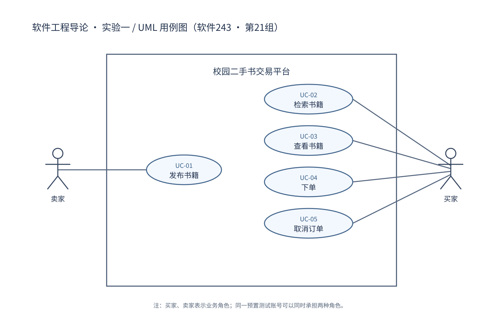

# 校园二手书交易平台 — 实验一需求规格说明（v0.5.6 跨组互评整改稿）

| 项目 | 信息 |
|---|---|
| 课程 | 软件工程导论实验 |
| 班级 / 小组 | 软件243班 / 第21组（三人组） |
| 项目 | 校园二手书交易平台 |
| 版本 | **v0.5.6，2026-11-06：根据第25组对第21组需求阶段的署名书面静态互评（基线 main@37e7f16）修订；已修改正文，待本组成员与外组对整改差异核对，非最终 lab1** |
| 主责与分工 | A（组长）：系统概述、UC-01、整合；B：FR-03～FR-06、UC-04；C：FR-07～FR-08、NFR、UC-05 |
| 依据 | 教师《第2次课需求分析学生材料》v1.4（2026-11-02），其中指导书为 v1.7；本仓库需求整合稿 v0.2及其保留的成员分析。教师要求以新版为准。 |

> **重要声明**：本稿为 **v0.5.6 跨组互评整改稿**，不是教师最终验收或已完成软件测试的记录。第25组评审人庞华杰（@Longqc666）在 [#6 静态互评意见](https://github.com/LianOldMan/se-software243-group21/issues/6#issuecomment-6678145017)和组间互评 Word 中对 v0.5.5 提出追踪、字段、异常验收与过程记录问题；本版由组长委托 AI 执行**文字整改**，不冒充 B/C 本人已经核验新版。组长曾转述 B/C 线下同意进入互评阶段，并非两人对 v0.5.6 的签名复核。教师约定 B-01～B-06、组内确认 R-01～R-05 和 §7 的 Q-01～Q-08 的来源分类保持不变；所有 AC 都是未来拟定验收标准，尚未执行功能、性能或可靠性测试。

## 1. 系统概述

### 1.1 背景与目标

校园闲置教材和其他二手书籍的信息常分散于聊天群等渠道，买家难以确定书籍是否仍可预留，卖家也要反复回复询问。本系统希望集中展示书籍发布记录和可售状态，让校园用户发布、查找书籍，并以“下单—取消”表达预留意向，减少重复沟通与预留冲突。

2026-11-02组长转述全组讨论方向：让平台更人性化、让用户使用顺心。后续细化应围绕信息容易理解、操作结果清楚、出错后知道如何处理展开；不因此增加支付、物流等范围外功能。

### 1.2 参与者与边界

- **卖家**：发布一本闲置书籍的信息。
- **买家**：检索与查看书籍、下单预留、取消本人有效订单。
- 同一个预置账号可以同时承担买家与卖家角色，不另设计角色切换流程。

范围包括四项核心业务：**发布书籍、检索与查看、下单、取消订单**。使用预置测试账号；一条发布记录代表一本实物书；下单只表示预留，不发生付款。范围**不含**账号注册/找回密码、真实支付、退款、物流、交易完成、评价、推荐、卖家下架或管理员后台。本实验只形成需求与模型，不实现程序。

### 1.3 教师确定的基本约定

| 编号 | 已确定的业务约定 |
|---|---|
| B-01 | 核心范围为发布、检索与查看、下单、取消订单。 |
| B-02 | 使用预置测试账号，不包含注册及找回密码。 |
| B-03 | 同一用户可兼任买家和卖家；一条发布代表一本实物书。 |
| B-04 | 下单表示预留而非支付；同一本书同时最多一个有效订单。 |
| B-05 | 仅订单买家本人可以取消；取消后原订单失效、书籍恢复可售、历史订单保留。 |
| B-06 | 不接入支付、退款、物流、交易完成、评价和推荐。 |

### 1.4 统一术语与状态

| 术语 | 定义 |
|---|---|
| 书籍发布记录 | 一条记录对应一本实物书籍，由卖家创建。 |
| 可售 | 该书目前没有有效预留订单，可以接受下单。 |
| 已预留 | 该书当前有一条有效订单，不可再次被成功预留。 |
| 有效订单 | 一条尚未被取消的预留订单。 |
| 已取消订单 | 由订单买家取消、已失效但历史保留的订单。 |
| 订单标识 | 唯一定位某一次下单产生的具体订单，而非只定位某本书。 |
| 发布时间 | 一条书籍发布记录**创建成功时**由系统自动生成的创建时间（例如 `created_at`）；用于检索结果默认从新到旧排序。卖家不填写或修改此字段，它不是图书的出版日期。 |

> **关键不变量**：单本书同时最多一条有效订单；成功下单后“有效订单”与书籍“已预留”相符；取消指定的当前有效订单后，该订单失效而历史保留；仅在该书没有其他有效订单（包括后来新建的有效订单）时恢复可售。**旧订单的取消请求不得修改后来新建的有效订单。**

### 1.5 来源说明与证据边界

| 标识 | 可定位来源 | 用途 |
|---|---|---|
| T-01 | 教师材料包 v1.4：01_第2次课课堂任务单.pdf，第2页“四～六” | 用例字段、失败保证、发布校验、竞争预留、取消与旧请求边界 |
| T-02 | 教师材料包 v1.4：03_实验一需求分析指导书.pdf，第1～2页“二～三” | 系统范围、需求简表、编号、验收写法 |
| T-03 | 同一指导书第3～4页“五”、第5～7页“八～十”；00_阅读与填写说明.txt | 报告结构、AI说明、互评、GitHub与最终提交 |
| B-01～B-06 | 本文§1.3，对教师约定的归纳 | 已给定业务边界，不代表组内自定规则 |
| R-01～R-05 | 本文§2，2026-11-02由组长转述全组同意 | 五条规则及§7细化方案已确认 |

v0.2需求表中未在正文定义的S系列来源编号已改为上述可定位依据；不据此推定存在真实访谈。NFR在v0.5按全组采纳的方案调整；分工沿用原稿。本次规则确认的依据是组长在对话中转述的全组意见，不代表AI参加了组会或完成了正式互评。教师只规定检索与查看的核心范围；字段按已确认R规则执行，匹配方式按§7已确认方案执行。

## 2. 小组业务规则 R-01～R-05（已确认）

| 编号 | 已确认规则 | 确认依据 | 当前状态 |
|---|---|---|---|
| R-01 | 书名、作者、价格、成色为发布必填字段；成色从近全新、轻微使用痕迹、明显使用痕迹中选择，另设选填说明。 | 2026-11-02组长转述全组同意候选规则。 | 已确认 |
| R-02 | 书名与作者采用包含匹配，去除检索输入首尾空格；同时填写时取AND。 | 同上；匹配方式已按§7方案确认。 | 已确认 |
| R-03 | 价格须为大于0、最多两位小数的有效数值；不合规时提示，不自动四舍五入。 | 同上；不允许0元赠书，最多两位小数，不自动四舍五入。 | 已确认 |
| R-04 | 同一账号不得下单预留自己发布的书。 | 同上；这是小组自定规则，不是教师原定要求。 | 已确认 |
| R-05 | 检索结果至少显示书名、价格、成色和可售状态。 | 同上；默认展示全部并标注状态，可筛选仅看可售。 | 已确认 |

确认记录：组长反馈“目前全组的讨论是让这个卖书平台更加的人性化，让客户用的顺心，候选规则全部同意”。本版据此确认五条规则正文，不补造每名成员的发言、讨论时间或检查结论。记录日期为收到反馈的日期，正式组间互评仍待进行。

## 3. 功能需求简表（8 条）

| 编号 | 需求陈述 | 来源 | 优先级 | 拟定验收方法：给定—操作—预期 | 用例 |
|---|---|---|---|---|---|
| **FR-01** | 卖家提交一本实物书籍的发布信息，校验有效后系统新增一条初始为“可售”的发布记录。必填字段为书名、作者、价格和成色；**发布时间由系统在成功创建发布记录时自动生成且卖家不可编辑**。 | B-01、B-03、T-01（发布边界）、R-01、R-03 | P1 | 给定预置卖家账号和有效的虚构书籍数据；提交发布；应恰好新增一条正确记录、初始“可售”，并有系统生成的创建时间，卖家不能通过表单指定或修改该时间。 | UC-01 |
| **FR-02** | 必填信息缺失、价格不合法或价格格式错误时，系统拒绝发布并指出问题，不新增记录。必填项与正数价格按已确认的R-01、R-03执行；价格最多两位小数，成色取§7固定选项；错误时指出字段及改法、保留已填内容，不自动改变价格。 | T-01（发布边界）、R-01、R-03 | P1 | 分别遗漏必填字段，或提交 0、负数、非数字价格；均应拒绝，告知问题，原数据不变。 | UC-01 |
| **FR-03** | 买家可以按书名关键词检索书籍，并可按作者筛选，系统返回符合条件的记录；书名和作者去除首尾空格后分别包含匹配，组合取AND；空条件返回当前状态筛选下的全部记录，默认按**系统生成的发布时间从新到旧排序**（见 §1.4）。无结果时保留条件并提供修改及清空入口。 | B-01、T-02（范围与需求整理）、R-02 | P1 | 准备书名或作者有差异、且含可售与已预留的记录；书名与作者组合检索仅返回同时满足包含匹配的记录；无输入时按状态筛选返回全部且默认发布时间倒序；无匹配时保留条件、提供修改与清空入口。 | UC-02 |
| **FR-04** | 用户可以查看书籍记录及其可售状态；检索结果至少展示书名、价格、成色、状态，默认包含已预留书籍且标明状态，提供“仅看可售”筛选；详情显示已发布的书名、作者、价格、成色、**当前可售状态**及选填说明。 | T-02（范围与需求整理）、R-02、R-05 | P1 | 准备同关键词下 1 条可售和 1 条已预留记录；默认列表两条均出现并标明状态，切换“仅看可售”仅出现可售记录；查看详情时核对书名、作者、价格、成色、状态及选填说明与对应发布记录一致。 | **UC-02（列表展示/筛选）、UC-03（详情查看）** |
| **FR-05** | 对符合预留条件的可售书籍下单，系统产生该书唯一有效订单，将书籍设为“已预留”，向买家返回**订单标识、结果及针对该订单的取消入口**；不发生付款。按R-04禁止预留自己发布的书。 | B-03、B-04、T-01（下单边界）、R-04 | P1 | 给定非发布者买家及可售书籍；下单；应恰好产生一条有效订单，返回标识，书籍变“已预留”，无支付环节。 | UC-04 |
| **FR-06** | 已预留书籍的新下单被拒绝，原状态不变；重复提交不得产生第二条有效订单；两人竞争预留同书时最多只能产生一条有效订单。按已确认R-04拒绝自购请求。 | B-04、T-01（竞争预留）、R-04 | P1 | 给定两名买家几乎同时预留同一本可售书；在其他条件正常时，一人成功另一人失败，最终只有一条有效订单；重复提交不新增有效订单。 | UC-04 |
| **FR-07** | 有效订单的买家本人可通过携带订单标识的入口发起取消，确认一次后提交；指定订单变为已取消并保留历史；仅在该书没有其他有效订单（包括新有效订单）时恢复“可售”，不得由旧订单请求释放新预留；展示最新状态且该订单取消入口不可继续操作。 | B-05、T-01（取消边界） | P1 | 给定买家自己的当前有效订单，取消完成时无其他有效订单；取消该订单；应仅该订单失效，历史可查，关联书籍恢复“可售”；已有新有效订单时按 FR-08 保护。 | UC-05 |
| **FR-08** | 越权、重复或针对已取消旧订单的取消请求被拒绝，不改变已有订单与书籍状态；旧请求不得影响新买家后来产生的有效订单。 | B-05、T-01（取消边界）、T-01（旧请求保护） | P1 | 给定他人订单或已经取消的旧订单；发起取消；应拒绝、说明原因且状态不变；尤其新有效订单保持有效。 | UC-05 |

**补充解释**：检索的空条件与非空条件使用同一状态筛选规则。订单标识由取消入口携带，用户无需手动复制；该入口归入下单与取消用例，不增加独立订单管理业务。

## 4. 非功能需求简表（已采纳，未实测）

来源：原C分析的质量属性及2026-11-02 AI细化建议，由组长转述全组一致同意采用。以下为未来验收目标。

| 编号 | 质量属性与需求 | 优先级 | 计划检查方法 | 状态 |
|---|---|---|---|---|
| NFR-01 | 响应性能：1000条书籍数据、10名用户并发操作时，检索、发布、下单、取消各类请求至少95%的端到端响应时间不超过2秒。 | P1 | 记录软硬件和网络环境，每类至少采集100次请求，按类统计；业务拒绝和系统故障分别记录，超时不得从样本中删除。准备足够可售书籍和有效订单支持场景。 | 目标已确认，未实测 |
| NFR-02 | 状态可靠性：正常、异常和竞争操作后订单与书籍状态一致；无重复有效订单、部分修改或旧请求破坏新预留。 | P1 | 覆盖竞争下单、重复提交、越权取消、重复取消、旧请求重放及处理中断，检查完整状态；不一致次数为0。 | 目标已确认，未实测 |
| NFR-03 | 易用性：5名首次使用者中至少4名无需查阅说明或他人指导，能完成发布、检索、预留、取消并正确理解结果。 | P1 | 用预置账号和虚构书籍开展任务观察；每人使用不同书籍避免意外竞争，预留任务使用他人发布的书；记录任务完成、求助和结果理解情况。 | 目标已确认，未实测 |

NFR-02检查执行可靠性，权限业务规则仍由FR规定。此前20并发、取消错误率1%、固定100组场景等候选参数由本版方案替代；原NFR-04/05仍不纳入本版。

## 5. 完整用例图与追踪矩阵

### 5.1 图与边界

- [完整用例图 v0.1：可编辑 drawio](软件243_21组_实验一_完整用例图_v0.1.drawio)
- [完整用例图 v0.1：PNG 阅读版](软件243_21组_实验一_完整用例图_v0.1.png)

2026-11-03 AI 辅助核对：系统边界为“校园二手书交易平台”，边界内为 UC-01～UC-05；卖家、买家在边界外。卖家关联发布书籍，买家关联检索、查看、下单、取消；共 5 条无向关联线，无 include/extend 或表达业务先后的连线。两个角色可由同一预置账号兼任。现有图的业务结构无需因本次文字修订而变化，继续保留 v0.1 文件名；B、C 已分别在 [#6 B 检查](https://github.com/LianOldMan/se-software243-group21/issues/6#issuecomment-6595754829) 和 [#6 C 检查](https://github.com/LianOldMan/se-software243-group21/issues/6#issuecomment-6595986574) 对 v0.5.3 与图的关系给出“内容通过”结论；C 又在 [v0.5.4 差异复核](https://github.com/LianOldMan/se-software243-group21/issues/6#issuecomment-6604657061) 确认本版相关说明通过。越权取消属于 UC-05 的异常路径，不将“越权者”另画成参与者；图结构未变。

### 5.2 FR—UC—成员追踪（8 FR / 5 UC）

| 用例 | 用户目标 | 参与者 | 对应需求 | 主责 |
|---|---|---|---|---|
| UC-01 发布书籍 | 发布一本书 | 卖家 | FR-01、FR-02 | A |
| UC-02 检索书籍 | 找到匹配书籍、在列表观察可售状态 | 买家 | FR-03、**FR-04（列表展示与可售筛选）** | B |
| UC-03 查看书籍 | 了解单本书信息及状态 | 买家 | FR-04（单书详情） | B |
| UC-04 下单 | 预留一本可售书 | 买家 | FR-05、FR-06 | B |
| UC-05 取消订单 | 撤销本人有效预留 | 买家 | FR-07、FR-08 | C |

本次按照教师要求，对 **UC-01、UC-04、UC-05** 三个用例作详细文字描述；UC-02、UC-03 保留于 B 的个人分析稿供追踪参考。五个用例在图中独立表达用户目标，不因操作先后添加 `include` / `extend`。B 的个人稿文件名仍为 `检索查看与下单分析_v0.1.md`：B 本人提交至文内 v0.3，[v0.4 的四处文字小修](https://github.com/LianOldMan/se-software243-group21/commit/f4e20b254bfe62f2c584d118e2c44e566f6af0de)由组长委托 AI 辅助完成，后续又按 C 的建议作[历史措辞清理](https://github.com/LianOldMan/se-software243-group21/commit/214f02fdd0839adbbf5e6d2f8403d8164427a907)。现行 B 稿 v0.4 的 §3.5 AC-02-1～9、§4.4 AC-03-1～6 可辅助追踪；四处问题已由 [C 在 #2 的真实复核](https://github.com/LianOldMan/se-software243-group21/issues/2#issuecomment-6625594696)确认通过，[#2 已关闭](https://github.com/LianOldMan/se-software243-group21/issues/2)。这些属于**B 稿的补充拟定验收**，未自动升级为本共享规格的正式 AC；跨稿引用须注明文件、版本与章节。

### 5.3 NFR—业务—计划检查追踪（3 NFR）

| 正式 NFR | 关联 FR / UC | 关联检查入口（均未执行） | 范围说明 |
|---|---|---|---|
| NFR-01 响应性能 | FR-01～08；UC-01～UC-05（UC-03 属检索结果后的信息查看） | §4 每类至少 100 次请求、1000 条书籍、10 并发、各类至少 95% ≤2 秒 | 仍只测已确认的发布、检索、下单、取消四类请求；FR-04/UC-03 的查看展示并入检索场景核对，不另设第五类独立查看请求或额外 P95 指标 |
| NFR-02 状态可靠性 | FR-01～08；UC-01～UC-05（UC-02/03 是只读观察入口） | §4 异常/竞争/处理中断检查；§6 AC-04-2/3/5、AC-05-2～7 等提供业务场景，检索列表与详情可观察书籍状态 | 发布、下单、取消及其竞争/异常是状态变更与可靠性检查重点；FR-03/04、UC-02/03 用于只读观察和核对状态一致性，**不新增状态变更来源、独立可靠性阈值或功能验收项**；不替代 FR 权限规则，也不将 UC-01 候选故障场景升级为正式业务 |
| NFR-03 易用性 | FR-01～08；UC-01～UC-05（查看作为检索/预留任务中的信息阅读） | §4 五名首次使用者至少四名独立完成四项任务并理解结果；§6、§7 提供结果与异常反馈 | 沿用发布、检索、预留、取消四项任务，不增加第五项独立用户测试任务 |

验收编号以共享稿的语义为准：UC-01→AC-01、UC-04→AC-04、UC-05→AC-05。B 个人稿文内 v0.4 包含 UC-02/03 补充拟定验收（§3.5 AC-02-1～9、§4.4 AC-03-1～6），原四处问题和修订过程见 [#2 二轮核验①～④](https://github.com/LianOldMan/se-software243-group21/issues/2#issuecomment-6596029708)、[C 对 v0.4 的通过评论](https://github.com/LianOldMan/se-software243-group21/issues/2#issuecomment-6625594696)。B 个人稿下单验收在外组互评整改中计划统一采用独立前缀 `AC-B-04-n`（见 B 稿实际修订提交），旧版 `AC-04-n` 仅作为历史编号保留；跨稿引用须明确文件、版本、章节和条件内容。C 稿 AC-07/08 为历史 FR 级分析，不计为共享新增验收或 FR。正式数量保持 **8 FR、5 UC、3 NFR**；FR-03a 的无结果处理已并入 FR-03（仅保留历史提法），FR-06a、NFR-04/05 等个人候选均不追加计数。

## 6. 三个详细用例描述

### UC-01 发布书籍（组长 A 主责；原个人版 v0.2 经 C 复核，当前 v0.3 补发布时间、待差异确认）

> 本节根据 [成员 C 在 Issue #1 的二次复核](https://github.com/LianOldMan/se-software243-group21/issues/1#issuecomment-6594187676) 整理；异常编号和验收编号与 UC-01 个人详细版一致。全部验收条件为拟定，未实测。

#### 1. 基本信息

| 字段 | 内容 |
|---|---|
| 用例编号 | UC-01 |
| 用例名称 | 发布书籍 |
| 目标 | 卖家提供一本闲置书籍的必要信息，系统确认输入有效后创建对应的发布记录，以便其他用户检索、查看和预留。 |
| 主要参与者 | 卖家（使用预置测试账号） |
| 触发条件 | 卖家发起“发布书籍”操作。 |
| 前置条件 | 当前操作者使用系统提供的预置测试账号，能够提交待发布的书籍信息；不预先要求输入信息符合规则。 |
| 成功后置条件 | 新增且只新增一条与本次提交相符的书籍发布记录，代表一本实物书；其初始状态为“可售”；系统自动记录**创建时间=发布时间**且卖家不能编辑；系统反馈发布成功及记录标识。 |
| 失败后保证 | 不新增书籍发布记录；已存在的书籍记录不改变；系统清楚指出失败原因、错误字段及修改方法，并保留已经填写的其他有效内容。 |
| 关联需求 | FR-01、FR-02；B-01、B-03；R-01、R-03、Q-05、Q-08（均已确认）。 |
| 相关用例 | UC-02 检索书籍、UC-03 查看书籍。发布成功的记录可供后续使用，不表示 include/extend 关系。 |
| 规则状态 | R-01、R-03 已由全组确认；当前具体规则及发布时间字段见统一需求 v0.5.6 的 §1.4/§3/§7。 |

#### 2. 正常流程

1. 卖家发起发布书籍操作。
2. 系统提供发布信息的填写入口，提示需要填写的字段：书名、作者、价格、成色。其中成色采用固定选项：
   - 近全新
   - 轻微使用痕迹
   - 明显使用痕迹

   卖家还可以填写选填说明。
3. 卖家填写一本实物书籍的信息，选择对应成色并提交。
4. 系统校验必填字段、成色选项及价格规则：
   - 书名、作者、价格、成色均不能为空；
   - 价格必须大于 0；
   - 价格最多保留两位小数；
   - 不符合价格精度要求时拒绝提交，不自动四舍五入修改用户输入。

   若不满足要求，转异常流程 A1～A4。
5. 校验通过后，系统创建一条新的发布记录，将状态置为“可售”并自动记录创建时间作为发布时间；卖家不得在发布表单填写或修改发布时间。
6. 系统向卖家反馈发布成功，显示书籍名称、发布记录标识及当前状态，并提供查看该书的入口。
7. 用例结束。

#### 3. 异常或备选流程

| 编号 | 触发条件 | 系统反馈 | 数据保证及后续处理 |
|---|---|---|---|
| A1 | 书名、作者、价格或成色任一必填项未填写（R-01）。 | 拒绝发布，明确指出缺少哪一项及如何填写。 | 不新增记录，原有记录不变，保留其他已经填写的内容；返回正常流程第2步修改后重新提交。 |
| A2 | 价格为0或负数（R-03）。 | 拒绝发布，提示价格必须大于0。 | 不新增记录，原有记录不变，保留已填写内容；返回第2步修改。 |
| A3 | 价格不是有效数值，或小数位超过两位，例如输入12.345。 | 拒绝发布，提示价格必须为有效数值且最多保留两位小数；不得自动修改为12.35。 | 不新增记录，保留用户原始输入及其他已填写内容；返回第2步修改。 |
| A4 | 成色不属于近全新、轻微使用痕迹、明显使用痕迹三个允许选项。 | 拒绝发布，提示选择有效成色，并展示允许的三个选项。 | 不新增记录，保留其他已填写内容；返回第2步重新选择。 |
| A5（候选异常） | 提交过程中系统发生故障，无法完成发布。 | 显示发布未完成，请稍后重试等提示，不得将失败反馈为成功。 | 不产生半完成的可见发布记录，已有记录不变。该异常作为候选场景保留，不视为新增的已确认业务规则。 |

#### 4. 验收条件（拟定，未实测）

| 编号 | 给定条件 | 执行操作 | 预期结果 |
|---|---|---|---|
| AC-01-1 | 卖家账号可用，准备一条书名、作者、价格、成色均有效的虚构教材数据，成色属于三个允许选项之一。 | 提交发布。 | 恰好新增1条发布记录；字段与输入一致；初始状态为“可售”；系统生成发布时间，反馈成功。 |
| AC-01-2 | 其他字段均有效，分别将书名、作者、价格或成色留空。 | 分别提交发布。 | 均拒绝发布，明确指出具体缺失字段及修改方法；不新增记录，并保留其他已填写内容。 |
| AC-01-3 | 其他字段有效。 | 分别将价格填为0、-5并提交。 | 均拒绝，提示价格必须大于0；不新增记录。 |
| AC-01-4 | 其他字段有效。 | 分别将价格填为非数字文本、12.345并提交。 | 拒绝发布，提示价格最多两位小数；不得自动改为12.35；保留原始输入，不新增记录。将价格修改为12.34后应允许正常提交。 |
| AC-01-5 | 其他字段有效，提交的成色值不属于三个允许选项。 | 提交发布。 | 拒绝发布，提示有效成色选项，不新增记录，保留其他已填写内容。若界面使用固定下拉选项，还应确保无效值不能被提交。 |
| AC-01-6 | 系统已有若干发布记录。 | 提交一条合法新记录并随后检索该书。 | 原有记录不变；新记录存在且状态为“可售”；可以被 UC-02 找到。 |
| AC-01-7 | 给定先后创建的两条书籍发布记录。 | 检查系统生成的发布时间并执行空条件检索。 | 每条记录都有不可由卖家任意填写/修改的创建时间，默认结果按新到旧排序（FR-03/Q-03）。 |

### UC-04 下单（成员 B 主责；已修正原稿前置条件）

| 字段 | 描述 |
|---|---|
| 编号与名称 | UC-04 下单 |
| 目标 | 买家对一本可售书籍发起预留，成功后取得一条有效订单。 |
| 主要参与者 | 买家 |
| 触发条件 | 用户提交针对某条书籍发布记录的下单预留请求。 |
| 前置条件 | 请求中给出目标书籍标识；测试环境提供预置账号机制。**不提前假设书籍存在、可售、没有有效订单或请求者不是卖家**，这些都由流程检查。 |
| 成功后置条件 | 恰好形成一条与该书、该买家关联的有效订单；书籍“已预留”；向买家返回订单标识；无支付行为。 |
| 失败后保证 | 不新建有效订单，不改变现有订单与书籍状态；说明失败原因。 |
| 关联需求 | FR-05、FR-06；B-03、B-04、B-06；R-04（已确认）。 |

**正常流程**

1. 买家提交目标书籍的下单预留请求。
2. 系统校验用户身份并确认书籍记录存在。
3. 系统检查书籍是否可售且当前不存在有效订单；按R-04检查请求者不是该书发布者。
4. 校验通过后，系统在完成预留时仍须保证同书最多一个有效订单；系统完成预留：建立唯一有效订单，书籍状态设为“已预留”，两者结果一致。
5. 系统返回订单标识、书籍名称及“已预留”状态，说明未发生付款，提供携带该订单标识的取消入口；用例结束。

**异常/备选流程**

| 编号 | 分支位置与条件 | 系统响应及结果 | 继续或结束位置 |
|---|---|---|---|
| A1 | 正常流程第2步，账号身份未得到确认。 | 拒绝并提示使用有效预置账号；本请求不改变订单或书籍。 | 本次用例结束。 |
| A2 | 正常流程第2步，书籍标识无效或记录不存在。 | 拒绝并说明目标不可用；不产生订单。 | 本次用例结束。 |
| A3 | 正常流程第3步，书籍已预留。 | 拒绝并提示不可售；已有有效订单和书籍预留状态不受本请求影响。 | 本次用例结束。 |
| A4 | 正常流程第3步，请求者为发布者，按已确认R-04处理。 | 拒绝自购并说明；不产生订单，不改变书籍状态。 | 本次用例结束。 |
| A5 | 正常流程第3～4步，同一请求重复到达，且首次请求已经成功（包括成功结果未送达、买家重试）。 | 不产生第二条有效订单，不将首次已成功的订单判为失败；返回与已有订单一致的结果或提示可核对；原有效订单和书籍状态不变。 | 重复请求结束；首次成功请求按第5步返回结果。 |
| A6 | 正常流程第3～4步，两名买家竞争同一本书；即使先前检查可售，完成预留时也须满足唯一有效订单约束。 | 在双方请求有效且系统正常时，一人成功，一人被拒绝并提示不可售；失败请求不改变成功方订单及书籍状态；失败方不获知成功买家的身份或订单详情。 | 成功方进入第5步；失败方用例结束。 |

**验收条件（拟定）**

| 编号 | 给定—操作—预期 |
|---|---|
| AC-04-1 | 给定符合下单条件的买家和可售书籍；提交下单；应有一条有效订单、书籍已预留、返回订单标识、无付款。 |
| AC-04-2 | 给定书籍已有有效订单；另一人提交；应拒绝且原订单状态不变。 |
| AC-04-3 | 给定两个有效买家同时预留同一本可售书；提交请求；应至多一个有效订单，在系统正常完成处理时一人成功、一人失败。 |
| AC-04-4 | 给定卖家本人请求预留自己发布的书；按R-04拒绝且状态不变。 |
| AC-04-5 | 给定买家 A 首次对书籍 X 下单已成功，但结果未送达；A 以同一请求重试；不得产生第二条有效订单，应返回与已有订单一致的结果或提示可核对，原订单及书籍状态保持一致。 |
| AC-04-6 | 给定 A、B 同时预留同一本可售书且 A 成功；B 刷新查看该书；应看到“已预留”、B 未取得预留，且不展示 A 的身份信息或订单详情。 |

> **UC-04 审查同步说明**：本版采纳 B 于 [Issue #3](https://github.com/LianOldMan/se-software243-group21/issues/3#issuecomment-6594172122) 中提出、组长 A 确认同意的 AC-04-5/6；AC-04 编号跟随 **UC-04**。成员 B 的扩展验收条目 AC-04-7～10 保留在个人分析稿供后续参考，涉及人为中断和异常数据构造的 AC-04-11/12 暂不并入本阶段共享验收简表。所有条件均未运行测试。

### UC-05 取消订单（成员 C 主责；已修正原稿前置条件）

| 字段 | 描述 |
|---|---|
| 编号与名称 | UC-05 取消订单 |
| 目标 | 买家撤销本人仍有效的预留订单，释放书籍并保留取消历史。 |
| 主要参与者 | 发起取消请求的用户（正常情形为订单买家；其他用户可能触发越权异常）。 |
| 触发条件 | 用户提交包含**具体订单标识**的取消请求。 |
| 前置条件 | 取消请求中给出订单标识；测试环境有预置账号机制。**不预先要求订单存在、有效或归当前用户所有**。 |
| 成功后置条件 | 被指定的当前有效订单变“已取消”并保留历史；仅在该书没有其他有效订单（包括新有效订单）时恢复可售，不影响其他订单。若取消完成后又形成新有效订单，书籍应保持与新订单一致的“已预留”，旧请求不得再次释放。 |
| 失败后保证 | 原订单、书籍及其他订单状态不变；返回可理解的拒绝原因。 |
| 关联需求 | FR-07、FR-08；B-05；T-01（取消边界）、T-01（旧请求保护）。 |

**正常流程**

1. 用户点击指定订单的取消入口；系统显示一次确认提示，用户确认后提交携带该订单标识的请求。
2. 系统校验用户身份，按订单标识定位目标订单。
3. 系统确认请求者是该订单的买家、订单当前有效，且关联书籍处于与有效预留一致的状态。
4. 系统在完成取消时再次确认指定订单仍有效且对应当前预留；取消该订单与更新关联书籍状态必须保持业务结果一致。把**指定订单**设为“已取消”并保留历史后，**仅在该书没有其他有效订单（包括后来新建的有效订单）时**将书籍恢复为“可售”。已取消的旧订单不重复执行状态变更；旧 O1 请求不能取消新 O2，也不能释放 O2 的书籍。
5. 系统反馈取消成功，显示该订单的最新状态及书籍当前状态，保留历史并使该订单的取消入口不可继续操作；无新有效订单时显示“可售”，若随后已被新订单预留则显示“已预留”，不得因旧取消结果覆盖新状态；用例结束。

**异常/备选流程**

| 编号 | 分支位置与条件 | 系统响应及结果 | 继续或结束位置 |
|---|---|---|---|
| A0 | 正常流程第1步，用户在确认提示中选择放弃。 | 不提交取消，不修改订单或书籍。 | 本次用例结束。 |
| A1 | 正常流程第2步，身份未验证通过，或订单标识无效、目标不存在。 | 拒绝并给出适当提示；不改变订单或书籍，不泄露无关订单信息。 | 本次用例结束。 |
| A2 | 正常流程第3步，请求者不是该订单买家。 | 拒绝越权取消；本请求不改变订单和书籍，提示不泄露无关订单信息。 | 本次用例结束。 |
| A3 | 正常流程第3步，指定订单已经取消，且同书当前没有后来新建的有效订单；若有新有效订单则转 A4。 | 提示“订单已取消，无需再次操作”，拒绝重复修改；不再次释放书籍。 | 本次用例结束。 |
| A4 | 正常流程第3步，旧订单O1已取消，同书已有新有效订单O2，O1取消请求再次到达。 | 拒绝旧请求；只按指定订单识别请求，不因书号相同而取消O2或释放书籍。O2仍有效，书籍仍已预留。 | 旧请求结束。 |
| A5 | 正常流程第3～4步，多个请求竞争取消同一个有效订单。 | 在请求有效且系统正常时，一次取消成功；其他请求按已取消处理且无副作用，不影响之后可能产生的新预留。 | 成功请求进入第5步；其余请求结束。 |

**验收条件（拟定）**

| 编号 | 给定—操作—预期 |
|---|---|
| AC-05-1 | 给定账号 A 自己的当前有效订单 O1，取消完成时该书无其他有效订单；A 取消 O1；应将 O1 设为已取消并保留历史，关联书籍恢复可售；后来若有新有效订单，旧请求不得再次释放书籍（见 AC-05-3）。 |
| AC-05-2 | 给定 O1 属于 A；其他账号 B 取消 O1；应拒绝并保持 O1、书籍状态不变。 |
| AC-05-3 | 给定 O1 已取消、B 随后创建有效订单 O2；再次请求取消 O1；应拒绝，O2 仍有效、书籍仍已预留。 |
| AC-05-4 | 给定 O1 已取消，且同一本书后来**没有**新建的有效订单；原买家 A 再次请求取消 O1；应说明订单已取消、无需再次操作，且不产生额外的订单或书籍状态变更。若同书已经存在新有效订单 O2，按 AC-05-3 核验，旧请求不得取消 O2 或释放其书籍。 |
| AC-05-5 | 给定本人有效订单 O1，两个取消请求几乎同时到达，且没有新有效订单；并发取消 O1；预期**至多一次**取消生效，O1 只转为“已取消”一次，书籍只释放一次，两个请求均安全反馈；**不出现订单已取消但书籍仍已预留、或书籍已可售但 O1 仍有效的半完成状态**。如果后续新建有效 O2，旧请求仍不得影响 O2（A5、NFR-02）。 |
| AC-05-6 | 给定未登录/会话失效，或携带无效、不存在的订单标识；尝试提交取消；预期拒绝并给出不泄露他人信息的提示，已有订单及书籍状态均不变（A1；越权见 AC-05-2）。 |
| AC-05-7 | 给定买家 A 的有效订单 O1；在取消前的确认提示中选择“放弃”；预期**不发起取消**，O1 仍有效，书籍仍已预留，不产生额外状态变更（A0）。 |

**与 C 个人稿的细化层次对应**

C 的 [取消订单与NFR分析_v0.2.md](取消订单与NFR分析_v0.2.md) §5.2 为 8 步详细展开，本节为 5 步共享表达，两者不是两套业务。异常编号均为 A0～A5，但步骤号必须在各自文档内解释，不直接混引。

| C 个人稿 §5.2 | 本节正常流程 | 对应动作 / 分支 |
|---|---|---|
| 第 1～3 步 | 第 1 步 | 点击、显示一次确认、确认提交；A0 放弃确认 |
| 第 4 步身份与标识校验 | 第 2 步 | 定位订单；A1 |
| 第 4 步归属、有效性及预留关系校验 | 第 3 步，并在第 4 步完成变更前复核 | A2 越权、A3 重复、A4 旧订单；A5 涉及竞争取消 |
| 第 5～6 步 | 第 4 步 | 取消指定订单、保留历史、按无其他有效订单条件释放书籍 |
| 第 7～8 步 | 第 5 步 | 反馈当前状态、禁用旧订单取消入口、结束 |

v0.5.3 根据 [B 在 #4 的二次复核](https://github.com/LianOldMan/se-software243-group21/issues/4#issuecomment-6594747505)明确无新有效订单才可售、保护新订单，整理 A0 排序和细化层次说明；v0.5.4 将 A3/A4 的分流写明并获 B/C 真实复核；**v0.5.5 再将相同限定同步至 AC-05-4**，使其与 AC-05-3 的适用条件区分开（[B 的具体建议](https://github.com/LianOldMan/se-software243-group21/issues/6#issuecomment-6609251597)）。C 个人稿 S-05/S-06 表示个人场景，T-01 表示教师材料来源，二者用途不同；共享 AC-05-1 包含“取消完成时无其他有效订单”限定。未将 C 的个人字段改作教师来源，也未替改成员个人稿。

> **关于订单入口**：UC-04成功后提供携带具体订单标识的取消入口，UC-05包含一次取消确认；已取消订单历史保留，入口不可再次操作。直接重复发送请求时仍须检查并安全反馈。

补充验收：从预留成功结果直接发起取消，无需手工输入订单标识；**A0 放弃确认见 AC-05-7，A1 身份或标识异常见 AC-05-6，A5 并发取消见 AC-05-5**；确认取消后历史保留、状态显示正确、入口不可继续操作；旧请求仍按 AC-05-3 处理。

## 7. 细节决策（全组已采纳）

| 编号 | 决策 | 对应位置 |
|---|---|---|
| Q-01 | 默认展示全部书籍并标注已预留，提供仅看可售筛选。 | FR-03/04、UC-02/03 |
| Q-02 | 书名、作者包含匹配，去除检索输入首尾空格，同时填写取AND。 | R-02、FR-03 |
| Q-03 | 空条件返回当前状态筛选下全部书籍，默认发布时间倒序；有条件检索同样遵守状态筛选。 | FR-03 |
| Q-04 | 禁止预留自己发布的书。 | R-04、UC-04 |
| Q-05 | 成色固定为近全新、轻微使用痕迹、明显使用痕迹，另设选填说明；价格>0且最多两位小数，不自动四舍五入。 | R-01/03、FR-01/02、UC-01 |
| Q-06 | 预留成功提供订单标识及取消入口，入口携带具体订单标识；取消前确认一次。 | FR-05/07、UC-04/05 |
| Q-07 | 采用§4三条覆盖整个平台的NFR及检查方法。 | NFR-01～03 |
| Q-08 | 错误指出字段及改法，校验失败保留输入；无搜索结果可修改或清空条件；取消显示状态、保留历史并禁用入口，重复请求提示无需再操作。 | FR-02/03/07/08、UC-01/05 |

检索验收补充：准备可售与已预留书籍，分别检查默认全量、仅看可售、空条件、书名与作者AND组合及无匹配结果；结果须与规则一致，空结果仍保留条件。查看书籍时，字段应与发布记录一致。

确认依据：2026-11-02组长反馈“我们一致同意，采用你说的这套方案”。上述决策据此记为已采纳；逐步走读、正式互评和未来运行测试仍需实际开展。

### 7.1 后续阶段未决事项清单（非已采纳 Q-01～Q-08）

| 个人问题及出处 | 当前状态 | 影响范围 | 待确认时点 |
|---|---|---|---|
| B-Q-04（B 个人分析） | 检索/查看是否允许未登录访问未由共享规则确定；“允许匿名”仅是个人建议 | UC-02/03 的前置与账号校验 | 实验二设计前由组内和课程要求确认 |
| B-Q-11（B 个人分析） | “显示可售但已经存在有效订单”的数据不一致如何拒绝/修复未采纳为正式流程 | FR-05/06、UC-04、不变量及数据约束 | 实验二设计数据库约束前由组内确认 |
| B-Q-12（B 个人分析） | 同一卖家重复发布同一本实物书如何判定仍待决定 | FR-01/02、唯一标识与发布校验 | 实验二建模前由组内确认 |
| C-Q-12（C 个人分析） | 预置账号具体数量与角色分配未定，已确认的只是使用预置账号 | 各用例、权限核验与测试数据 | 实验二准备数据前核对教师要求 |

> **已撤回而非待决**：B-Q-06 曾建议详情展示卖家标识/发布时间，但未采纳为正式需求。本次“发布时间”是系统自动生成的内部排序字段，**不要求详情显示**。本清单不增加正式 FR/NFR，也不修改 §7 已采纳的八条 Q。

## 8. 需求一致性与下一步评审

1. **需求覆盖**：FR-01/02 → UC-01；FR-03 → UC-02；**FR-04 → UC-02（列表展示/状态筛选）+ UC-03（单本书详情）**；FR-05/06 → UC-04；FR-07/08 → UC-05。保持 **8 FR / 5 UC / 3 NFR**，不拆出第九条 FR、不更改 UML 结构。
2. **三个详细用例字段**：UC-01、UC-04、UC-05 都含目标、参与者、触发、前置条件、成功/失败保证、正常/异常流程、关联需求和可检查验收方法。
3. **NFR**：按全组采纳方案更新NFR-01、02、03及其检查方法，**没有宣称任何实际测试通过**。
4. **修正原草案矛盾**：B、C 的 UC-04/UC-05 原稿前置条件排除了本应讨论的异常情形，本版已改为“请求提供标识、校验在流程中完成”。
5. **组内与跨组互评状态**：B/C 对 v0.5.4 有 [B 真实评论](https://github.com/LianOldMan/se-software243-group21/issues/6#issuecomment-6609251597)和 [C 真实评论](https://github.com/LianOldMan/se-software243-group21/issues/6#issuecomment-6604657061)；v0.5.5 线下“可以继续互评”由组长转述，并有[#6 版本差异说明](https://github.com/LianOldMan/se-software243-group21/issues/6#issuecomment-6625952856)。第25组评审人 @Longqc666 于 2026-11-06 对 v0.5.5 开展有署名的[静态互评](https://github.com/LianOldMan/se-software243-group21/issues/6#issuecomment-6678145017)并反馈。**v0.5.6 为整改后的新版本，尚待本组与对方对修改效果进行复核**；不将 #6 旧 7/7 结项或外组对旧版本的评价当作新版通过。
6. **图文一致性**：后续修改须核对报告与共享文档中的清晰用例图、用例名称和规则；现有绘图源文件可保留，但新版不要求提交或上传源文件或单独导出图。
7. **AI 辅助说明**：本版由 AI 根据 A、B、C 现有草案辅助整合；需要组长与组员人工复核、记录采纳决定及实际使用证据。不要把本文件的“建议/修订”描述为已完成组会或教师评价。

### 8.1 本轮整合检查与未决事项

v0.5.3、v0.5.4 的 B/C 组内复核及 #6 结项都是历史真实记录；v0.5.5 的差异说明已在 #6 补发，线下同意继续互评由组长转述。2026-11-06 第25组 @Longqc666 对 v0.5.5 提出有证据的[静态互评意见](https://github.com/LianOldMan/se-software243-group21/issues/6#issuecomment-6678145017)。**本 v0.5.6 针对该评价修订** FR/UC 追踪、系统生成发布时间、UC-05 A0/A1/A5 的可编号验收和未决清单，并同步个人稿/Issue/仓库结构。未收到组员或外组对 v0.5.6 的新核验结论，尚不能记为正式最终版。

- #1～#6：六个组内 Issues 均 Closed；#6 的 7/7 属于已核验的 v0.5.4 阶段；#3 过去有“已关闭但最后一项未勾”的记录缺口，需依据 B 原作者提交与 A 本人既有评论据实补齐，不新增虚构的检查人。
- #2：B 本人提交个人稿至 v0.3；组长委托 AI 代修为 v0.4，[C 的真实复核](https://github.com/LianOldMan/se-software243-group21/issues/2#issuecomment-6625594696)已确认四处修改通过，#2 现为 7/7 Closed。个人 B-Q-04、B-Q-11、B-Q-12 等候选仍不因此变成全组正式规则。
- #6：历史 B/C 评论仅证明 v0.5.4 的组内复核；[v0.5.5 版本说明](https://github.com/LianOldMan/se-software243-group21/issues/6#issuecomment-6625952856)和[第25组 v0.5.5 的静态互评](https://github.com/LianOldMan/se-software243-group21/issues/6#issuecomment-6678145017)是后续证据；**本 v0.5.6 仍须单独做差异核验**。
- **待决而非默认采纳**：B-Q-04/B-Q-11/B-Q-12、C-Q-12 已汇总于 §7.1，分别注明影响与计划确认时点；B-Q-06 已撤回，不作为待确认的正式详情展示字段。
- 性能、状态可靠性和易用性验收均未实施；正式跨组互评、最终 Word 报告与 lab1 提交尚待按教师要求完成。

## 9. 新版报告与提交要求

依据T-03，截止时间为下次实验课开始前（第3次课，即数据库设计第一次课），不是本次课结束即必须最终交齐。

- 每人使用04_实验报告一模板.docx，保留首页、实验目的、实验器材、实验内容栏目；填写实际日期、实际工具与版本，成绩栏留空。
- 实验内容依次展开：系统概述；本人模块（名称、范围、输入输出、模块关系、具体工作）；需求简表与业务规则；完整用例图及说明；全部三个详细用例与验收条件；需求与用例对应及评审修订；个人贡献、小结、来源和工具说明。
- 每份个人报告均须独立包含完整用例图及UC-01、UC-04、UC-05，不能仅写本人负责的一个用例。
- 组长统一提交“班级_组号_实验一_需求分析.zip”，仅放每人一份“学号_姓名_实验一.docx”（或DOC）及全组一份“互评与提交记录.docx”。后者使用本次02号模板，真实互评后填写，个人报告引用它。
- 不另交PDF报告、单独图文件、绘图源文件、用例工作表、文件清单、版本登记表或过程截图包。现有过程材料可在仓库保留供核验。
- GitHub继续保存脱敏共享成果与真实协作记录；README提供看板和成果入口，个人报告提供本人Issue或贡献链接。身份完整的个人报告走课程渠道。
- 先完成 **v0.5.6** 的组员差异核验和第25组反馈处理复核，再统一三个个人 Word、最终共享提交与 lab1 完整提交链接。**本版为跨组互评整改稿，不是最终教师验收版。**
- AI使用与关键交互写入报告；选择实际有影响的2～3次，不足时如实填写。人工采纳决定、核验、正式组间互评和个人贡献必须据实填写。

### v0.3 AI辅助修订记录（历史记录，不代替人工核验）

- 日期与工具：2026-11-02，ChatGPT / Codex。
- 输入：教师第2次课材料包v1.4（指导书v1.7）、仓库requirements.md v0.2及现有提交说明。
- 请求：完成第一步，将需求整合稿修订为符合新版要求的待人工确认稿。
- 输出：补齐三个用例异常分支位置、系统结果和返回/结束位置；改用可定位来源；同步新版报告和提交要求。
- 采用位置：本文§1.5、§3～4来源栏、§6异常流程、§8～9及README和待填写记录中的提交说明。
- 人工采纳决定、人工修改及核验证据：**待实际核验后填写**。保留R、Q和NFR候选状态，本次不新增已完成互评或实测结论。

### v0.4 规则确认与同步记录（历史状态，后续决策见v0.5）

- 输入依据：2026-11-02组长反馈全组同意候选规则，并强调人性化、使用顺心。
- 本次处理：确认§2五条规则；同步§3、§6及§7；不改变FR、UC编号或系统边界。
- 易用性细化建议（待确认，不计为新增已确认规则）：字段错误提示说明如何改正；校验失败保留已填内容；预留/取消后直观显示当前状态；无检索结果时提供调整条件的提示。
- NFR中的性能阈值、样本量及易用性量化比例尚需单独落实；未宣称实测通过。正式互评、逐步走读及个人核验证据仍据实补充。

### v0.5 方案采纳记录

2026-11-02，ChatGPT / Codex依据用户转述的全组一致同意，将上一轮NFR与待确认问题建议纳入§2～7。理由为全组提出的“更合理、更人性化”。已同步功能需求、用例及验收条件；本次完成文本一致性检查，人工逐步走读和正式互评尚待记录，所有性能与用户任务测试均未实施。

## 10. 版本记录

| 版本 | 日期 | 变更内容 | 状态 |
|---|---|---|---|
| v0.1 | 2026-10-27 | 原始 8 条 FR、5 个 UC 及 R-01～R-05 候选规则。 | 历史讨论稿 |
| v0.2 | 2026-11-01 | 整合 B/C 需求分析，增加 3 条 NFR 候选，纳入 UC-01/04/05 详细描述，修订前置条件及订单标识衔接。 | **待全组人工核验、待阶段互评** |
| v0.3 | 2026-11-02 | 对齐材料包v1.4/指导书v1.7；补异常分支与流程出口，明确来源，更新报告与提交要求。 | **待人工确认、待正式组间互评** |
| v0.4 | 2026-11-02 | 根据组长转述全组意见确认R-01～R-05，同步FR及UC中的字段、正数价格与自购限制，记录易用性方向。 | 规则已确认，细节与NFR指标待落实，正式互评待完成 |
| v0.5 | 2026-11-02 | 根据全组采纳意见确定NFR及Q-01～08，统一检索、成色、价格、错误恢复和取消交互。 | 方案已确认，待交叉检查及正式互评，未实测 |
| v0.5.1 | 2026-11-03 | 按成员 C 对 UC-01 v0.2 的二次复核意见，同步 §6 的 A1～A5、AC-01-1～6 与流程；不修改既有 R/NFR 决策。 | UC-01 内容已获 C 二次复核通过；其他用例和组间互评待完成，未实测 |
| v0.5.2 | 2026-11-03 | 依据 B 在 #3 的逐条回复及组长 A 的同意，统一 UC-04 异常语义，新增 AC-04-5/6；已确认 R-04/NFR 等业务方案不变。 | 组长已采纳 B 的 UC-04 修改方案；B 个人稿仍需清理历史“暂定”状态；正式跨组互评待完成，未实测 |
| v0.5.3 | 2026-11-03 | Issue #6：补图文与 NFR 追踪；收紧 UC-05/FR-07 的释放条件，保护新有效订单；A0～A5 排序；标明 8 步/5 步及跨稿编号引用边界。 | B、C 已分别在 #6 对本版组内复核并表示主体内容通过；未实测、未跨组互评 |
| v0.5.4 | 2026-11-03 | 依据 B/C v0.5.3 意见补 NFR-01 与 FR-04/UC-03 追踪、检索/查看验收判据、UC-02/03 补充验收定位、UC-05 A3/A4 分流和真实评审状态。 | B/C 已分别在 #6 对本版差异复核通过，#6 组内任务已关闭；非最终 lab1、未实测、未跨组互评 |
| v0.5.5 | 2026-11-04 | 根据 B 的四条编辑建议调整 AC-05-4/FR-04/NFR-02 与 #2 溯源；v0.5.5 是第25组审阅的主要共享需求版本。 | B/C v0.5.4 评论已归档；第25组对 v0.5.5 提供了书面静态互评意见，见 #6；非最终 lab1 |
| v0.5.6 | 2026-11-06 | 根据第25组互评，FR-04 对 UC-02/03 的双向追踪；定义系统生成发布时间；新增 UC-05 的 AC-05-5/6/7；§7.1 集中列出未决事项，配套清理 B 个人稿和 Issue/目录记录。 | AI 辅助文字整改；**待 B/C 与第25组核对本版修改**，未实测，非最终 lab1 |