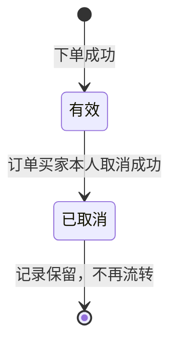
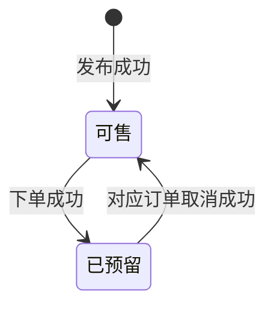
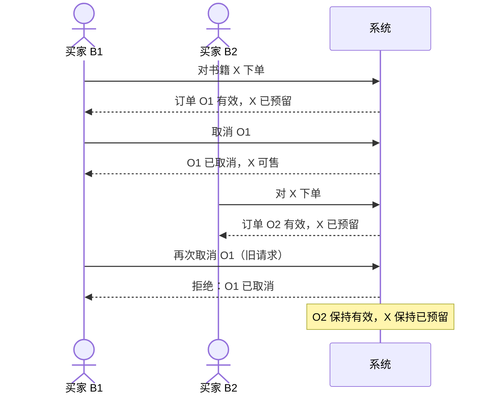

# 软件243班第21组 实验一 · 取消订单与NFR分析（UC-05 修订稿 v0.2）

> **文档信息**
>
> | 项目 | 内容 |
> | --- | --- |
> | 课程 | 软件工程导论 |
> | 班级 / 小组 | 软件243班 / 第21组 |
> | 项目 | 校园二手书交易平台 |
> | 对应需求 | FR-07、FR-08 |
> | 对应用例 | UC-05 取消订单 |
> | 编写 | **彭靖毅（成员 C，学号 32406300074，GitHub `Elyeye1111`）** |
> | 版本 | v0.2（UC-05 按 B/A 评审意见修订；以共享 v0.5.2 为基线） |
> | 日期 | 2026-11-03 |
> | 状态 | **历史 v0.2 已由 B（廖浩廷）在 #4/#5 留下真实二次复核通过证据**；实验一最终共享需求为 v0.5.6，新增 AC-05-5～7 仅在共享稿内；NFR 指标为目标/检查方法，未执行测试 |
> | 建议仓库路径 | `requirements/取消订单与NFR分析_v0.2.md` |

> **声明**
>
> 1. 本稿是成员 C 的课程作业讨论稿，不是组内已经通过的结论。
> 2. 文中“成员 C 意见”是个人分析；涉及共享结论的部分以 v0.5.2 为准。本稿没有虚构组员讨论、测试结果或已完成的协作记录。
> 3. 所有 NFR 数字都是**小组目标/检查值**，不是教师给定的数值，也没有经过实测；不得写成“已经满足”或“测试通过”。
> 4. 2026-10-29 已对照《第1次课学生材料 v1.4》核对 `B-01～B-06`、`S-01～S-06` 及提交要求；教师材料原文在本地课程包中，仓库未附，引用仍以课堂材料为准。
> 5. 第二次课要求 3 个详细用例；第 5 节是 C 主责的 UC-05 历史 v0.2 分析，B 已在 #4 二次复核通过；最终新增 AC-05-5～7 以共享 v0.5.6 为准。个人报告还需包含 UC-01、UC-04、UC-05 三个用例，不能只写 UC-05。
> 6. **基线声明：** 共享 `requirements/requirements.md` **v0.5.2（2026-11-03）** 是最终依据。本稿 §5 的 UC-05 验收统一使用 `AC-05-1～AC-05-4`；§7 只把 NFR-01～03 作为小组正式三条，NFR-04/05 为个人补充；§9 个人历史问题统一改用 `C-Q-xx`，与共享 `Q-01～Q-08` 分开引用。

> **版本定位（v0.2）：** 本稿是在 v0.1 个人分析稿基础上的修订版，用于回应 Issue #4 中 B 的真实交叉检查、以及组长委托的 AI 辅助核对意见。它在 2026-11-03 写成时还不是组内已通过版本；此后 B 已对当时稿件二次复核，第25组完成跨组书面静态互评，2026-11-09 组长又转述 B/C/第25组线下认可共享 v0.5.6 的整改。以上是**后续进度补注**，不改写历史提交或冒充新 GitHub 审查；任何运行测试都尚未发生。

---

## 0. 结论摘要

1. **取消的对象是订单，不是书籍。** 取消请求必须能唯一确定一条订单；不能把“取消这本书的当前订单”当作取消语义，否则场景三的旧请求会误伤新订单。
2. **只有订单买家本人可以取消。** 其他买家、非该订单买家的卖家、未登录用户都不能取消；如果卖家本人就是该订单买家，则按买家本人处理；R-04 已由 v0.5.2 确认禁止自购，但它是小组自定规则，不是教师原定要求；本课程范围没有定义管理员代取消。
3. **正常取消后的终态：** 订单由“有效”变为“已取消”，记录保留；关联书籍由“已预留”变为“可售”；其他买家可以重新下单。
4. **重复取消、越权取消、旧订单取消都应被拒绝。** “拒绝”指不执行取消、不改变订单/书籍/历史状态，并返回可理解的原因；这不等于一定要返回某个 HTTP 状态码。
5. **旧请求不能影响新订单，靠的是“订单身份 + 状态前置条件”。** 旧订单 O1 已经是终态“已取消”，再次取消 O1 只能失败；新订单 O2 是另一条记录，旧请求没有指向 O2，也不应被解释为“取消这本书现在的订单”。
6. **历史订单只增不删。** 取消是状态变化，不是删除；至少保留订单标识、书籍标识、买家、状态、创建/取消时间、操作者。
7. **NFR 与业务规则分开写。** “一本书最多一条有效订单”是业务不变量，不再单独算作 NFR；小组正式三条 NFR 是性能、状态可靠性、易用性，可追溯性和持久性仅作为个人补充。
8. **教师材料 v1.4 已核对。** `B-01～B-06`、`S-01～S-06` 与小组引用一致；第二次课要求 3 个详细用例，UC-05 已按第二次课字段定稿，仍待 B 二次复核。与本稿配套的提交检查和 AI 记录模板见第 13 节、附录 C。

---

## 1. 分析范围、依据与方法

### 1.1 范围内

- 取消有效订单（FR-07）。
- 拒绝越权取消、重复取消、旧订单取消请求（FR-08）。
- UC-05 取消订单的正常流与异常流。
- 与取消订单直接相关的非功能需求候选。
- 对 R-01～R-05 的对照意见（v0.1 建议 vs v0.5.2 最终状态）。
- 待确认业务规则与问题清单。

### 1.2 范围外

按教师约定，本阶段不涉及：

- 注册、找回密码；
- 真实支付、退款、物流、交易完成；
- 评价、推荐；
- 管理员后台、卖家下架/删除书籍等未被教师材料明确要求的功能；
- 数据库表结构、锁、类方法、接口协议等设计/实现细节。

> 本稿只描述“业务上应发生什么”和“如何客观检查”，不提前规定实现方式。文中出现的“按订单标识定位”“条件更新”等说法是需求层的约束说明，不是要求采用某种数据库或框架。

### 1.3 依据

| 编号 | 依据 | 本稿使用方式 |
| --- | --- | --- |
| B-01～B-06 | 教师材料 v1.4 的基本业务约定（已核对） | 取消订单主要引用 B-05；B-02/B-03/B-04/B-06 用于边界、角色和排除范围 |
| S-01～S-06 | 教师材料 v1.4 的讨论场景卡（已核对） | S-05 对应场景三，S-06 对应场景二 |
| R-01～R-05 | 第21组候选补充规则 | v0.5.2 已确认；本稿第 8 节对照 C 的 v0.1 建议与最终状态 |
| FR-07、FR-08 | 小组 `requirements.md` v0.1 | 本稿分析并给出修订建议 |
| UC-05 | 小组用例图 v0.1 | 本稿补充用例描述与异常流 |
| 任务单/指导书 | 教师材料 v1.4 的 01、02 文件 | 用于第 13 节的课程要求对照与提交前检查 |
| 项目起始模板 | 教师材料 v1.4 的 06 文件 | 仅用于目录、README、AI 记录格式对照；模板中的 UC-04 是示例，不是本组编号 |

### 1.4 分析方法（五步）

1. **定边界**：先确认哪些行为在本次实验内，哪些不写，避免把支付、物流等后续业务混进取消流程。
2. **定对象**：把“用户、书籍发布记录、订单、历史订单、取消请求”分开；特别区分“订单标识”和“书籍标识”。
3. **定权限**：用账号身份判断“是不是订单买家”，而不是用“当前页面角色”或“是不是卖家”判断。
4. **走场景**：每个场景都写清前置条件、触发、正常结果、异常结果、终态和不变量；场景三要按时间顺序走一遍。
5. **提质量**：把业务规则和质量要求分开；NFR 必须能通过观察、测量或抽样检查，阈值标明“候选/待确认”。

### 1.5 成员 C 负责范围（个人说明）

> 这一段用于回答课程要求的“本人负责模块/子系统的名称、功能范围、输入输出、与其他部分的关系、本人具体工作”。它是个人说明，不是组内分工决议；3 人组中 D 的检索/追踪工作由谁分摊，仍需组会确认。

| 项目 | 内容 |
| --- | --- |
| 功能范围 | 取消订单（FR-07）、拒绝越权/重复/旧请求（FR-08）、UC-05 取消订单、取消异常场景、NFR 整理、待确认规则汇总 |
| 输入 | 教师材料 v1.4 的 `B-01～B-06`、`S-01～S-06`；小组 `requirements.md` v0.5.2；用例图 v0.1；v0.5.2 已确认的 `R-01～R-05` |
| 输出 | 本稿；FR-07/FR-08 修订建议；UC-05 描述；三场景与并发变体；正式 NFR-01～03 对照 + 个人补充 NFR-04/05；R-01～R-05 评审意见；个人历史问题 C-Q-01～C-Q-16 |
| 与其他部分的关系 | 依赖 A 的发布记录（书籍来源）和 B 的下单（订单创建、有效订单）；取消结果影响书籍“可售/已预留”状态和检索展示；3 人组中检索/追踪由谁分摊待组会确认 |
| 本次实际分析/修改及证据位置 | 本稿第 3～9 节、第 13 节；未修改小组原始 `requirements.md`，未执行测试，未进行组内评审 |
| 尚未承担 | 发布、检索、下单的详细需求；完整用例图绘制；个人报告模板填写；GitHub Issue/Projects 操作 |

---

## 2. 术语、角色与状态

### 2.1 术语表

| 术语 | 本稿定义 | 说明 |
| --- | --- | --- |
| 预置测试账号 | 教师提供的、事先存在的账号 | 不涉及注册和找回密码 |
| 买家 / 卖家 | 业务角色，不是两个独立账号 | 同一账号可以同时承担买家和卖家角色 |
| 书籍发布记录 | 一条代表一本实物书的记录 | 不是“书目”或“ISBN 条目” |
| 可售 | 书籍当前没有被有效订单占用 | 可以被买家下单 |
| 已预留 | 书籍当前被一条有效订单占用 | 不能再被其他买家下单 |
| 订单 | 一次下单预留产生的记录 | 不代表付款，不代表交易完成 |
| 有效订单 | 状态为“有效”、仍占用对应书籍的订单 | 本书同一时刻最多一条 |
| 已取消订单 | 曾经有效、后被买家本人取消的订单 | 业务上也称“失效”；记录保留 |
| 历史订单 | 已取消订单及其记录 | 不物理删除，供查询/追溯 |
| 取消请求 | 用户针对某一条订单发起的取消操作 | 必须能唯一确定订单 |
| 拒绝 | 不执行取消，返回原因，不改变业务状态 | 与“系统错误”不同 |

### 2.2 角色与取消权限

| 角色 | 能否取消当前订单 | 说明 |
| --- | --- | --- |
| 订单买家本人 | 能 | 以账号身份与订单买家一致为准 |
| 其他买家 | 不能 | 越权；即使知道订单号也不能取消 |
| 卖家（非该订单买家） | 不能 | 教师约定只有订单买家本人可以取消；卖家下架/取消不在本实验范围 |
| 同一账号兼任卖家与买家 | 视订单归属而定 | 若其本人就是该订单买家，按“买家本人”处理；R-04 已确认禁止自购，但属于小组自定规则 |
| 未登录 / 会话失效 | 不能 | 拒绝并提示登录；不得泄露订单信息 |
| 管理员 | 本实验未定义 | 如教师要求管理员代取消，需另行补充规则，不能默认存在 |

> **结论：** 取消权限的判断依据是“当前账号是否为该订单的买家”，不是“当前页面是买家视图还是卖家视图”，也不是“是否知道订单号”。

### 2.3 状态与状态机

**订单状态：**

**书籍状态：**

| 当前状态 | 事件 | 允许？ | 结果 |
| --- | --- | --- | --- |
| 订单：有效 | 买家本人取消 | 是 | 订单→已取消；书籍→可售；历史保留 |
| 订单：有效 | 非买家取消 | 否 | 拒绝；订单、书籍不变 |
| 订单：已取消 | 任何人再次取消 | 否 | 拒绝；订单、书籍不变 |
| 订单：不存在 | 取消 | 否 | 拒绝；不产生记录变更 |
| 书籍：可售 | 取消（无有效订单） | 否 | 拒绝；不存在可取消的有效订单 |
| 书籍：已预留 | 对应订单买家取消 | 是 | 书籍→可售 |
| 书籍：已预留 | 其他订单/其他人取消 | 否 | 拒绝；书籍保持已预留 |

### 2.4 业务不变量

以下是不变量，不是 NFR；它们用于判断每个场景的终态是否正确。

- **I1**：同一本书同一时刻至多存在一条有效订单。
- **I2**：若一条订单有效，则其关联书籍状态为“已预留”，且没有被其他有效订单占用。
- **I3**：已取消订单不被物理删除；历史可查询。
- **I4**：订单状态只能从“有效”转为“已取消”，不能从“已取消”恢复为“有效”。
- **I5**：取消请求只影响其明确指向的那一条订单，不按书籍“推断”当前订单。
- **I6**：取消不产生支付、退款、物流或交易完成记录。

---

## 3. FR-07 分析与修订建议

### 3.1 现有表述

> **FR-07**：有效订单的买家本人可以取消订单；取消后该订单失效、历史记录保留，关联书籍恢复“可售”。

### 3.2 逐项分析

| 现有要素 | 分析 | 需要补什么 |
| --- | --- | --- |
| “有效订单” | 方向正确，但没有定义“有效”的起止 | 明确：下单成功即为有效；取消成功即终止；本实验不设支付/完成状态 |
| “买家本人” | 需要可检查的身份判断 | 明确按账号 ID 与订单买家一致判断，不按角色页面判断 |
| “可以取消” | 没有说明取消的对象 | **必须写明取消的是“订单”，请求要能唯一确定订单** |
| “订单失效” | “失效”与“已取消”混用 | 统一术语：状态用“已取消”，业务含义可写“失效” |
| “历史记录保留” | 正确，但没写保留什么 | 至少保留订单标识、书籍标识、买家、状态、创建/取消时间、操作者 |
| “书籍恢复可售” | 正确，但没写前提 | 仅当该订单确实是书籍当前有效订单，且没有其他有效订单时，才恢复可售 |
| 取消原因 | 教师材料未要求 | 暂不作为必填；是否填写原因列为待确认 |
| 取消后的再次下单 | 未写 | 建议明确：取消成功后，其他买家可以重新下单；原买家是否可立即再下单待确认 |
| 通知卖家 | 未写 | 本实验不涉及通知；不要默认增加 |

### 3.3 修订建议（供全组讨论）

> **FR-07（修订建议 v0.2）**
>
> 订单买家本人可对一条仍为“有效”状态的订单发起取消。系统应以订单标识定位订单，校验：①操作者账号为该订单买家；②订单当前状态为“有效”；③订单关联书籍当前由该订单预留。校验通过后，系统将订单状态改为“已取消”，记录取消时间与操作者，保留该订单及其历史记录，并将关联书籍状态改为“可售”。取消不涉及支付、退款、物流或交易完成。取消成功后，其他买家可对该书重新下单；同一本书同一时刻仍至多一条有效订单。

**为什么这样改：**

- 把“取消对象”写清楚，直接支撑场景三。
- 把“身份、状态、书籍预留关系”写成三个校验条件，便于验收。
- 把“历史保留”具体化为可检查的记录字段。
- 不引入“取消原因”“通知卖家”等教师未要求的规则。

### 3.4 FR-07 验收要点

> 以下 `AC-07-x` 是 **FR-07 的历史分析编号**，用于保留 v0.1 的 FR 级检查思路；UC-05 的正式验收见 §5.5 的 `AC-05-1～AC-05-4`。报告引用 UC-05 时不要引用 `AC-07`。

| 编号 | 给定条件 | 执行操作 | 预期结果 |
| --- | --- | --- | --- |
| AC-07-1 | 买家 B 有一条有效订单 O，书籍 X 为“已预留” | B 取消 O | O 变为“已取消”；X 变为“可售”；O 仍可查询 |
| AC-07-2 | 同上 | B 取消 O 后，买家 C 对 X 下单 | C 成功创建新有效订单 O2；X 变为“已预留” |
| AC-07-3 | 同上 | 取消后查看历史订单 | O 仍在历史中，状态为“已取消”，取消时间/操作者可见 |
| AC-07-4 | 同上 | 取消后检查支付/退款/物流记录 | 不产生任何支付、退款、物流或交易完成记录 |
| AC-07-5 | 订单 O 已取消 | 再次取消 O | 拒绝；O 仍为“已取消”；X 状态不被旧请求改变 |

> 以上是拟定验收方法，不是已经执行的测试结果。

---

## 4. FR-08 分析与修订建议

### 4.1 现有表述

> **FR-08**：非订单买家、已取消订单的旧请求不能改变当前有效订单和书籍状态；重复取消或越权取消应被拒绝并说明原因。

### 4.2 拒绝矩阵

| 请求者 | 订单状态 | 是否为该订单买家 | 结果 | 业务状态变化 |
| --- | --- | --- | --- | --- |
| 买家本人 | 有效 | 是 | 允许取消 | 订单→已取消；书籍→可售 |
| 买家本人 | 已取消 | 是 | 拒绝（重复取消） | 无 |
| 其他买家 | 有效 | 否 | 拒绝（越权） | 无 |
| 其他买家 | 已取消 | 否 | 拒绝（越权/旧请求） | 无 |
| 卖家（非买家） | 有效/已取消 | 否 | 拒绝（越权） | 无 |
| 任何人 | 不存在 | — | 拒绝（订单不存在） | 无 |
| 任何人 | 无法唯一确定订单 | — | 拒绝（请求不合法） | 无 |

### 4.3 逐项分析

1. **“非订单买家”**：要覆盖其他买家、卖家（非该订单买家）、未登录用户。判断依据是账号，不是页面角色。
2. **“已取消订单的旧请求”**：旧请求的目标是旧订单 O1；O1 已经是终态，不能再取消。它不能因为“同一本书”而被解释为取消新订单 O2。
3. **“重复取消”**：同一买家对同一条已取消订单再次取消。建议拒绝并提示“该订单已取消”，而不是再次执行取消。
4. **“越权取消”**：非买家取消。建议拒绝；提示语是否区分“无权”与“订单不存在”需要小组确认，避免泄露订单是否存在。
5. **“说明原因”**：原因应是用户能理解的自然语言，不是内部错误码或数据库术语；至少能区分“无权”“已取消”“订单不存在/已失效”。
6. **并发**：取消与下单、取消与取消同时发生时，最多一个请求完成状态转换；失败请求不能留下“半取消”状态。
7. **请求标识**：如果请求只带书籍 ID、不带订单 ID，系统无法知道要取消哪一条订单；应拒绝，不能猜测“当前有效订单”。

### 4.4 修订建议（供全组讨论）

> **FR-08（修订建议 v0.2）**
>
> 系统应拒绝下列取消请求，并保证订单、书籍和历史记录不发生改变：①操作者不是该订单买家；②订单标识不存在、非法或不足以唯一确定订单；③订单已处于“已取消”状态（重复取消）；④旧订单已取消后，其取消请求在书籍被新订单预留后再次到达；⑤取消与下单或其他取消并发，请求未能在订单仍有效时完成状态转换。拒绝时应返回可理解的原因，不得删除历史、不得把当前有效订单置为取消、不得把已被新订单预留的书籍改为“可售”。

**说明：**

- “拒绝”是业务结果，不等于必须使用某个 HTTP 状态码；具体响应格式属于设计阶段。
- 第⑤条不规定锁或事务实现，只要求“失败请求不产生部分修改”。
- 对越权请求，反馈不应泄露不必要的订单/个人信息；具体文案待确认。

### 4.5 旧请求为什么不能影响新的有效订单

这是场景三的核心，建议全组统一理解：

1. **请求指向的是订单记录，不是书籍。** 旧取消请求携带的是 O1 的订单标识；O1 已经“已取消”，再次取消只能失败。
2. **新订单是另一条记录。** O2 有新的订单标识、新的买家、新的创建时间；旧请求没有指向 O2，系统也不应把“取消 O1”翻译成“取消 X 的当前订单”。
3. **状态前置条件阻止二次流转。** 取消成功的前提是“订单仍为有效”；O1 不满足，因此不会再次修改 O1，更不会修改 O2。
4. **并发时也不例外。** O2 的创建前提是 O1 已取消、X 已恢复可售。如果 O1 取消与 O2 创建同时到达，系统应串行化处理：若 O1 取消先完成，则 X 可售，O2 可以创建；若 O2 创建先被处理而 O1 仍有效，则 O2 应被拒绝，直到 O1 取消成功后才能重试。无论哪种顺序，针对 O1 的取消请求都只能作用于 O1，不能让 O2 变成已取消，也不能把 X 从 O2 的预留中释放。
5. **如果请求只带书籍 ID，结论是“拒绝”。** 因为无法唯一确定订单；不能猜测“当前有效订单”并取消它。

### 4.6 FR-08 验收要点

> 以下 `AC-08-x` 是 **FR-08 的历史分析编号**，用于保留 v0.1 的 FR 级检查思路；UC-05 的正式验收见 §5.5 的 `AC-05-1～AC-05-4`。报告引用 UC-05 时不要引用 `AC-08`。

| 编号 | 给定条件 | 执行操作 | 预期结果 |
| --- | --- | --- | --- |
| AC-08-1 | 买家 B 的有效订单 O，买家 C 已登录 | C 取消 O | 拒绝；O 仍有效；书籍仍“已预留” |
| AC-08-2 | 买家 B 的订单 O 已取消 | B 再次取消 O | 拒绝；O 仍“已取消”；书籍状态不变 |
| AC-08-3 | O1 已取消，B2 已创建新订单 O2，书籍 X 已预留 | 发送针对 O1 的旧取消请求 | 拒绝；O2 仍有效；X 仍“已预留” |
| AC-08-4 | 不存在订单号 | 取消 | 拒绝；不产生状态变化 |
| AC-08-5 | 请求只带书籍 X，不带订单标识 | 取消 | 拒绝；不猜测当前订单 |
| AC-08-6 | 同一订单 O 收到两个并发取消请求 | 同时执行 | 最多一个成功；O 最终“已取消”；无重复业务记录/无半取消状态 |
| AC-08-7 | O1 取消与 O2 创建并发 | 同时执行 | 若 O1 取消先完成，O2 可成功；若 O2 先处理而 O1 仍有效，O2 被拒绝；O2 不受 O1 旧请求影响；I1～I5 仍成立 |

> 以上是拟定验收方法，不是已经执行的测试结果。

---

## 5. UC-05 取消订单用例描述

> **说明：** 本节是第二次课要求的 3 个详细用例之一（UC-05），已按 B 在 Issue #4 的评审意见修订 5.1、5.2；仍需核对全部字段和至少 2 个有业务意义的异常或备选场景，并等 B 二次复核。个人报告还要包含 UC-01、UC-04，不能只写 UC-05。

### 5.1 基本信息

| 项目 | 内容 |
| --- | --- |
| 用例编号 | UC-05 |
| 用例名称 | 取消订单 |
| 目标 | 买家取消自己仍有效的订单，释放书籍，同时保留历史 |
| 主要参与者 | 订单买家本人 |
| 异常参与者 | 其他已登录用户（越权/旧请求） |
| 触发条件 | 买家在订单结果页或订单入口选择指定订单的“取消订单”入口 |
| 前置条件 | 测试环境提供预置账号机制；取消请求携带具体订单标识。不预先要求订单存在、有效或归当前用户所有。 |
| 成功后置条件 | 指定订单“已取消”；历史保留；关联书籍“可售”；记录取消时间/操作者；其他订单不受影响 |
| 失败后保证 | 指定订单、书籍、历史及其他订单均不变；返回可理解的原因；不泄露无关订单信息 |
| 关联需求 | FR-07、FR-08；B-05；S-05、S-06 |
| 验收条件 | 见 5.5 节 `AC-05-1～AC-05-4`；原 `AC-07/08` 保留在第 3.4、4.6 节，作为 FR 级历史分析，不用于 UC-05 最终引用 |

> **编号说明：** 按共享 v0.5.2，UC-05 的验收条件统一使用 `AC-05-x`。原个人稿的 `AC-07-x / AC-08-x` 是按 FR 编号的历史分析，不删除、不混用；报告和 Issue 引用 UC-05 时只引用 `AC-05-1～AC-05-4`。

### 5.2 主成功流

1. 买家在订单结果页或订单入口点击指定订单的“取消订单”入口。
2. 系统显示订单及关联书籍摘要，并显示一次确认提示。
3. 买家确认取消。
4. 系统校验登录态，按订单标识定位目标订单；确认订单存在、请求者是该订单买家、订单当前有效，且关联书籍处于与有效预留一致的状态。
5. 系统将指定订单状态改为“已取消”，记录取消时间和操作者，保留订单历史。
6. 系统将关联书籍状态改为“可售”（仅在无其他有效订单时）。
7. 系统向买家显示取消成功、订单最新状态和书籍当前可售状态；该订单的取消入口不可继续操作。
8. 用例结束。

### 5.3 异常流

| 编号 | 触发位置 | 触发条件 | 系统响应/结果 | 继续/结束位置 |
| --- | --- | --- | --- | --- |
| A0 | 主成功流第 1～2 步 | 买家在确认提示中选择放弃 | 不提交取消，不修改订单或书籍 | 本次用例结束 |
| A1 | 主成功流第 4 步 | 身份未验证通过，或订单标识无效、目标订单不存在 | 拒绝并给出适当提示；不改变订单或书籍；不泄露无关订单信息 | 本次用例结束 |
| A2 | 主成功流第 4 步 | 请求者不是该订单买家 | 拒绝越权取消；本请求不改变订单和书籍；提示不泄露无关订单信息 | 本次用例结束 |
| A3 | 主成功流第 4 步 | 指定订单已经取消 | 提示“订单已取消，无需再次操作”，拒绝重复修改；不再次释放书籍 | 本次用例结束 |
| A4 | 主成功流第 4 步 | 旧订单 O1 已取消，同书已有新有效订单 O2，O1 的取消请求再次到达 | 拒绝旧请求；只按指定订单识别请求，不因书号相同而取消 O2 或释放书籍；O2 仍有效，书籍仍已预留 | 旧请求结束 |
| A5 | 主成功流第 4～5 步 | 多个请求竞争取消同一个有效订单 | 在请求有效且系统正常时，一次取消成功；其他请求按已取消处理且无副作用，不影响之后可能产生的新预留 | 成功请求进入第 5 步；其余请求结束 |

> **候选异常 A6（未纳入共享 v0.5.2）：** 若发现“书籍状态与订单状态不一致”的数据异常，建议拒绝并记录，转人工/待确认，不擅自修改；该场景保留为后续数据设计讨论，不作为本次 UC-05 的已确认验收项。

### 5.4 业务规则

- **BR-01**：只有订单买家本人可以取消。
- **BR-02**：取消请求必须唯一确定一条订单；不能按书籍推断当前订单。
- **BR-03**：只有“有效”订单可以取消；已取消订单不能再次取消。
- **BR-04**：同一本书同一时刻至多一条有效订单。
- **BR-05**：取消后订单历史保留，不物理删除。
- **BR-06**：取消不涉及支付、退款、物流、交易完成。

### 5.5 验收条件（拟定，未实测）

> 以下四条与共享 v0.5.2 的 UC-05 验收编号一致，是报告和 Issue 中应引用的正式验收条件。全部为计划检查方法，本阶段没有运行测试。

| 编号 | 给定条件 | 执行操作 | 预期结果 |
| --- | --- | --- | --- |
| AC-05-1 | 买家 A 拥有自己的有效订单 O1，书籍 X 为“已预留” | A 取消 O1 | O1 变为“已取消”并保留历史；X 恢复“可售”；不产生支付/退款/物流记录 |
| AC-05-2 | O1 属于买家 A，买家 B 已登录 | B 取消 O1 | 拒绝；O1 仍有效；X 仍“已预留”；提示不泄露 A 的无关订单信息 |
| AC-05-3 | O1 已取消，买家 B 随后创建有效订单 O2，X 已预留 | 再次发送针对 O1 的旧取消请求 | 拒绝；O2 仍有效；X 仍“已预留”；旧请求不修改 O2 |
| AC-05-4 | O1 已取消 | A 再次取消 O1 | 提示已取消并拒绝重复修改；O1 仍“已取消”；X 状态不被重复释放 |

**补充验收（不新增共享编号，报告中可用文字说明）：**

- 只带书籍 ID、不带订单 ID 的取消请求应被拒绝，系统不得猜测“这本书当前的有效订单”。
- 同一订单收到两个并发取消请求时，最多一个成功；不得出现重复业务记录或“取消了一半”的状态。
- O1 取消与 O2 创建并发时：若 O1 取消先完成，O2 可成功；若 O2 先处理而 O1 仍有效，O2 应被拒绝；O2 不受 O1 旧请求影响。
- 取消成功后查询历史订单，应能看到订单标识、书籍标识、买家、状态、取消时间/操作者；取消入口不可继续操作。

---

## 6. 场景分析

### 6.1 场景一：买家正常取消自己的有效订单

| 项目 | 内容 |
| --- | --- |
| 前置 | 买家 B 登录；B 拥有书籍 X 的有效订单 O；X 为“已预留” |
| 步骤 | B 打开订单 O → 选择取消 → 系统校验通过 → 系统执行取消 |
| 预期 | O 变为“已取消”；X 变为“可售”；O 历史保留；B 看到成功提示 |
| 不变量 | I1～I6 均成立 |
| 额外检查 | 不产生支付/退款/物流记录；其他订单不受影响 |

### 6.2 场景二：其他用户尝试取消不属于自己的订单（对应 S-06）

| 项目 | 内容 |
| --- | --- |
| 前置 | 买家 B 的有效订单 O；用户 C 已登录但不是 O 的买家 |
| 步骤 | C 尝试取消 O |
| 预期 | 拒绝；O 仍“有效”；X 仍“已预留”；C 看到无权/失败提示 |
| 不变量 | I1～I5 均成立 |
| 额外检查 | 拒绝后保持不变：O 的状态、X 的状态、O 的历史记录、其他订单；提示不应泄露不必要的订单信息 |

### 6.3 场景三：取消后重新下单，旧请求再次到达（对应 S-05）

| 时刻 | 操作 | 订单 O1 | 订单 O2 | 书籍 X | 说明 |
| --- | --- | --- | --- | --- | --- |
| t0 | B1 对 X 下单 | 有效 | — | 已预留 | 创建 O1 |
| t1 | B1 取消 O1 | 已取消 | — | 可售 | 正常取消 |
| t2 | B2 对 X 下单 | 已取消 | 有效 | 已预留 | 创建 O2 |
| t3 | 旧请求：再次取消 O1 | 已取消 | 有效 | 已预留 | 拒绝；O2 不受影响 |
| t4 | 查询历史 | 已取消 | 有效 | 已预留 | O1、O2 都可查 |

**关键检查点：**

- t3 的请求必须携带 O1 标识；如果只带 X 标识，应拒绝，不能猜测 O2。
- t3 不能把 X 改为“可售”，否则会破坏 O2 的预留。
- t3 不能把 O2 改为“已取消”。
- t4 的历史中，O1 和 O2 是两条独立记录，状态分别是“已取消”和“有效”。

### 6.4 并发变体

| 场景 | 并发操作 | 期望 |
| --- | --- | --- |
| C1 | 同一订单 O 的两个取消请求 | 最多一个成功；O 最终“已取消”；另一个拒绝；无重复业务记录 |
| C2 | B1 取消 O1 与 B2 创建 O2 同时到达 | 若 O1 取消先完成，则 O2 可成功；若 O2 先被处理而 O1 仍有效，则 O2 应被拒绝；最终要么 O2 有效且 X 已预留，要么 O2 不存在且 X 可售；旧请求不影响 O2 |
| C3 | 两个买家同时对同一本“可售”书下单 | 最多一个有效订单；另一个拒绝；I1 成立（属于 FR-06，但与取消后的重新下单相关） |

### 6.5 场景覆盖检查表

| 检查项 | 场景一 | 场景二 | 场景三 | 并发变体 |
| --- | --- | --- | --- | --- |
| 权限判断 | ✓ | ✓ | ✓ | ✓ |
| 订单状态变化 | ✓ | — | ✓ | ✓ |
| 书籍状态变化 | ✓ | — | ✓ | ✓ |
| 历史保留 | ✓ | — | ✓ | ✓ |
| 旧请求隔离 | — | — | ✓ | ✓ |
| 拒绝原因 | — | ✓ | ✓ | ✓ |

---

## 7. 非功能需求（NFR）：正式三条与个人补充

### 7.1 基线声明

本稿 v0.1 中的 NFR-01～NFR-05、20 并发、200 次取消、100 组场景等，都是**历史候选**，不是共享 v0.5.2 的正式指标。共享 `requirements/requirements.md` **v0.5.2 §4** 只正式采用 NFR-01～NFR-03；NFR-04/05 保留为个人补充，不计入小组最终三条 NFR。

> 所有指标都是目标或检查方法，**没有运行测试、没有用户实测**，不得写成“已满足”或“测试通过”。

### 7.2 小组正式三条 NFR（与 v0.5.2 §4 一致）

| 编号 | 质量属性 | 需求与指标 | 优先级 | 计划检查方法 | 状态 |
| --- | --- | --- | --- | --- | --- |
| NFR-01 | 性能 | 1000 条书籍数据、10 名用户并发操作时，检索、发布、下单、取消各类请求至少 95% 的端到端响应时间不超过 2 秒。 | P1 | 记录软硬件和网络环境；每类至少采集 100 次请求，按类统计；业务拒绝与系统故障分开记录，超时不得从样本中删除。 | 目标已确认，未实测 |
| NFR-02 | 状态可靠性 | 正常、异常和竞争操作后，订单与书籍状态一致；无重复有效订单、部分修改或旧请求破坏新预留。 | P1 | 覆盖竞争下单、重复提交、越权取消、重复取消、旧请求重放及处理中断；检查完整状态；不一致次数为 0。 | 目标已确认，未实测 |
| NFR-03 | 易用性 | 5 名首次使用者中至少 4 名无需查阅说明或他人指导，能完成发布、检索、预留、取消并正确理解结果。 | P1 | 用预置账号和虚构书籍开展任务观察；每人使用不同书籍，预留任务使用他人发布的书；记录完成、求助和结果理解情况。 | 目标已确认，未实测 |

### 7.3 个人补充 NFR-04/05（不纳入最终三条）

| 编号 | 质量属性 | 个人补充内容 | 处理 |
| --- | --- | --- | --- |
| NFR-04 | 可追溯性 | 每次取消尝试（成功或拒绝）记录订单标识、操作者、时间、结果/原因；抽 20 条成功 + 20 条拒绝，字段完整率 100%。 | 个人建议，未纳入 v0.5.2；报告中只能作为补充，不得算作小组正式 NFR。 |
| NFR-05 | 数据持久性 | 10 次正常重启/恢复后，已取消状态和历史记录不丢失，一致率 100%。 | P2 个人建议，取决于课程是否要求运行环境；未实测。 |

### 7.4 历史候选指标处理

| 历史候选 | 本稿处理 |
| --- | --- |
| 20 并发、200 次有效取消、系统错误率 ≤1% | 已被 v0.5.2 的“10 并发、每类至少 100 次请求、95% ≤2 秒”替代；不得与正式指标混用。 |
| 100 组编排场景 | 作为 NFR-02 的个人检查思路保留；正式目标以“不一致次数为 0”表述，不把 100 组写成已确认阈值。 |
| 5 名用户、至少 4 名完成 | 与 v0.5.2 NFR-03 一致，可作为正式检查方法。 |
| NFR-04/05 | 个人补充，不计入最终三条；报告中如需提及，必须标注“未采纳候选”。 |

### 7.5 FR/NFR 分类

“同一本书最多一个有效订单”“只有订单买家本人能取消”等是**业务规则/不变量**，不重复算作 NFR。NFR-02 检验的是多种异常/竞争后的状态一致性，不是把业务规则换名计数。

---

## 8. 业务规则 R-01～R-05：个人建议与 v0.5.2 最终状态

> 评审身份：成员 C。下表把 v0.1 的个人建议与共享 `requirements.md` v0.5.2 §2 的最终确认结果对照。v0.5.2 已确认 R-01～R-05；本表不再把已确认规则写成“待全组评审”。

### 8.1 对照表

| 规则 | v0.1 个人建议 | v0.5.2 最终状态 | 对 C 建议的处理 |
| --- | --- | --- | --- |
| R-01 | 书名、作者、价格、成色必填；去首尾空白后非空；价格为数值；成色用固定枚举 | 已确认：四项必填；成色从“近全新、轻微使用痕迹、明显使用痕迹”中选择，另设选填说明 | 采纳；枚举值和“选填说明”已写入共享稿 |
| R-02 | 书名关键词包含匹配；作者筛选可选；组合取 AND；空条件/排序需明确 | 已确认：书名、作者去首尾空格后包含匹配；同时填写取 AND；空条件返回当前筛选下全部，默认发布时间倒序 | 采纳 |
| R-03 | 价格 >0、最多两位小数、不自动四舍五入；0 元赠书需确认 | 已确认：必须为大于 0、最多两位小数的有效数值；不合规提示，不自动四舍五入；不允许 0 元赠书 | 采纳 |
| R-04 | 术语改“下单预留”；按账号判断“自己”；这是小组候选规则，不是教师规定 | 已确认：同一账号不得下单预留自己发布的书；共享稿明确标注“小组自定规则，不是教师原定要求” | 采纳；保留了“非教师规定”的说明 |
| R-05 | 结果至少显示书名、价格、成色、可售状态；已预留是否展示、无结果提示需明确 | 已确认：默认展示全部并标注状态，可筛选仅看可售；无结果时保留条件并提示 | 采纳 |

### 8.2 仍需注意的边界

- **R-04 的依据要写清。** 教师材料只把“能否购买自己发布的书”列为待确认细节，并没有规定禁止；v0.5.2 已把它确认为小组规则，报告中必须标注“小组自定规则”，不能写成教师要求。
- **R-02/R-05 更接近功能/展示规则，不是 NFR。** 它们落到 FR-03/FR-04；不要为了凑 NFR 数量把它们算成质量属性。
- **不要新增教师未要求的能力。** 取消原因必填、订单超时自动取消、卖家下架/删除等，仍不纳入本次核心范围。

### 8.3 跨规则一致性

1. 术语统一用“下单/预留”“有效/已取消”“买家/卖家”；“购买”只在不涉及本系统支付语义时作解释。
2. R-02 与 R-05 要一起维护：前者说“怎么查”，后者说“查到后看到什么”。
3. R-04 与 FR-05/FR-06 的验收要互相对应：卖家本人下单应被拒绝，且不能出现“页面能点、提交才失败”的静默失败。

---

## 9. 个人历史问题与共享 Q 的编号对照

### 9.1 编号规则

- 共享 v0.5.2 §7 的 `Q-01～Q-08` 是**已采纳决策**，是报告和 Issue 的正式引用编号。
- 本稿 v0.1 的 `Q-01～Q-16` 是个人历史问题，语义与共享稿不同。为避免歧义，本稿统一改称 `C-Q-01～C-Q-16`，不得直接写成共享 `Q-xx`。
- 下表按语义映射，不按编号硬套；已由共享稿解决的，引用共享结论；共享稿未纳入的，保留为个人补充或范围外。

### 9.2 语义对照表

| 个人历史编号 | 原问题 | 共享对应/结论 | 状态 |
| --- | --- | --- | --- |
| C-Q-01 | 取消请求用订单 ID 还是书籍 ID？ | 共享 Q-06：入口携带具体订单标识；不能按书籍猜测当前订单。 | 已由共享稿解决 |
| C-Q-02 | 重复取消是拒绝还是幂等成功？ | 共享 Q-08：重复请求提示无需再操作，不重复释放书籍。 | 已由共享稿解决 |
| C-Q-03 | 越权提示是否区分“无权”和“订单不存在”？ | 共享 Q-08 要求错误提示清楚；隐私口径（不泄露他人订单）为个人补充。 | 部分解决，隐私口径待设计 |
| C-Q-04 | 卖家能否取消/下架自己发布的书籍？ | B-01/B-06 未纳入卖家下架；本实验不加入。 | 范围外 |
| C-Q-05 | 取消是否必须填写原因？ | 共享稿未要求；本实验不作为必填。 | 个人补充，暂不作为必填 |
| C-Q-06 | 订单是否有超时自动取消？ | 教师只约定“有效/已取消”；本实验不加入超时。 | 范围外 |
| C-Q-07 | 取消后原买家能否立即重新下单？ | B-04/FR-06：书籍恢复可售后可作为新订单重新预留。 | 已由共享稿解决 |
| C-Q-08 | 历史订单保留哪些字段、多久？ | B-05 要求历史保留；字段细化为个人建议。 | 原则已解决，字段待设计 |
| C-Q-09 | 书籍删除/账号停用后还能取消吗？ | 未纳入本实验范围。 | 范围外 |
| C-Q-10 | 已预留书籍是否出现在检索结果？ | 共享 Q-01：默认展示全部并标注，可筛选仅看可售。 | 已由共享稿解决 |
| C-Q-11 | 是否允许 0 元赠书？ | 共享 R-03：价格必须大于 0。 | 已由共享稿解决 |
| C-Q-12 | 预置账号数量与角色？ | B-02 使用预置账号；具体数量未规定。 | 个人补充，待课堂确认 |
| C-Q-13 | NFR 并发、P95、样本取多少？ | 共享 NFR-01～03 已给出正式目标。 | 已由共享稿解决 |
| C-Q-14 | “有效订单”是否只由取消结束？ | 本实验只有“有效/已取消”，不涉及支付、完成、超时。 | 已由共享稿解决 |
| C-Q-15 | 取消是否需要二次确认？ | 共享 Q-06：取消前确认一次。 | 已由共享稿解决 |
| C-Q-16 | R-04（禁止自购）是否纳入？ | 共享 R-04/Q-04 已确认禁止自购。 | 已由共享稿解决 |

> 报告引用时：共享决策写 `Q-01～Q-08`；个人历史问题写 `C-Q-xx`。不要把个人 `C-Q-01` 写成共享 `Q-01`。

---

## 10. 追踪矩阵

| 需求 | 用例 | 主要场景 | 相关 NFR | 相关规则 |
| --- | --- | --- | --- | --- |
| FR-07 取消有效订单 | UC-05 主成功流 | 场景一 | NFR-01、NFR-02、NFR-03（NFR-04/05 为个人补充） | B-05 |
| FR-08 拒绝越权/重复/旧请求 | UC-05 异常流 A1～A5 | 场景二、场景三、并发变体 | NFR-02、NFR-03（NFR-04 为个人补充） | B-05、S-06 |
| R-01 发布必填 | UC-01 | 不直接涉及取消 | —（历史字段可由 NFR-04 个人补充） | v0.5.2 已确认 |
| R-02 检索 | UC-02 | 不直接涉及取消 | NFR-01（若含检索性能） | v0.5.2 已确认 |
| R-03 价格大于 0 | UC-01 | 不直接涉及取消 | — | v0.5.2 已确认 |
| R-04 禁止自购 | UC-04 | 影响“卖家是否能成为买家” | NFR-02（权限边界） | v0.5.2 已确认（小组自定） |
| R-05 检索结果字段 | UC-02/03 | 影响取消后书籍状态展示 | NFR-03（可理解性） | v0.5.2 已确认 |

---

## 11. 与共享 requirements.md v0.5.2 的对应关系

> 本节不再重复“请修改共享稿”的 v0.1 清单；共享稿已经更新到 v0.5.2。这里只说明本稿与共享稿的关系，以及 C 还需要做什么。

| 内容 | 共享 v0.5.2 状态 | 本稿处理 |
| --- | --- | --- |
| FR-07/FR-08 | 已整合取消需求、异常规则和旧请求保护 | 本稿保留 FR 级分析与 AC-07/08 历史验收；UC-05 正式引用改为 AC-05-1～4 |
| UC-05 | 已有统一描述，使用 AC-05-1～4 | 本稿第 5 节按 v0.5.2 重写，并补详细异常位置 |
| NFR-01～03 | 已正式采纳，指标见 §4 | 本稿第 7.2 节原样对照，不另造阈值 |
| NFR-04/05 | 未纳入正式三条 | 本稿第 7.3 节标为个人补充 |
| R-01～R-05 | 已确认 | 本稿第 8 节改为“个人建议 vs 最终状态”对照 |
| Q-01～Q-08 | 共享稿已采纳决策 | 本稿用 `C-Q-xx` 区分个人历史问题，见第 9 节 |
| 仍需 C 做 | Issue #4/#5 的真实回复、commit、B 二次复核 | 见配套 handoff 清单；不要把“已改本地稿”写成“已完成复核” |

---

## 12. 建议的全组评审步骤

以下只是建议议程，不是已经发生的会议记录。

1. **10 分钟：术语与边界**——确认“订单/书籍”“有效/已取消”“买家本人”的定义；确认卖家不能取消。
2. **15 分钟：FR-07/FR-08**——逐条读修订文本，重点确认“取消对象是订单”“重复取消是拒绝”。
3. **15 分钟：场景三**——按第 6.3 节时间线走一遍；再讨论并发变体；确认旧请求不碰新订单。
4. **10 分钟：NFR**——复核正式 NFR-01～03 与 v0.5.2 §4 的指标是否一致；NFR-04/05 只作个人补充，不挤进正式三条。
5. **10 分钟：R-01～R-05**——v0.5.2 已确认，重点复核措辞和 R-04“小组自定规则”的标注，不再重复讨论是否纳入。
6. **10 分钟：分工与记录**——谁改 `requirements.md`、谁补用例图、谁记录 AI 使用；下次检查前完成。

**评审后的最低交付：**

- FR-07/FR-08 修订文本进入 `requirements.md`；
- 正式 NFR-01～03 有编号、指标和检查方法；NFR-04/05 只作个人补充；
- R-01～R-05 有明确状态（不能只写“组长同意”）；
- 个人历史问题 `C-Q-01～C-Q-16` 中 P0 项有结论；共享 `Q-01～Q-08` 按 v0.5.2 §7 引用。
- 不在文档中写“已测试/已通过”，除非真的执行并留下记录。

---

## 13. 与教师材料 v1.4 的对照与补充

### 13.1 课程要求对照

| 课程要求 | 本稿对应位置 | 当前状态 |
| --- | --- | --- |
| 系统概述、业务背景、范围 | 第 1、2 节；完整概述由小组在 `requirements.md` / `scope.md` 统一 | 本稿只覆盖取消相关，不能替代小组系统概述 |
| 本人负责模块说明 | 第 1.5 节 | 已写功能范围、输入输出、关系、证据位置、尚未承担 |
| 6—10 条功能需求 | 小组 `requirements.md` 已有 FR-01～FR-08 | 本稿只修订 FR-07/FR-08，不重复列全部 FR |
| 至少 3 条可检查 NFR | 第 7 节：正式 NFR-01～03；NFR-04/05 为个人补充 | 正式 3 条与 v0.5.2 §4 一致；未实测 |
| 完整用例图 | 小组 `requirements/软件243_21组_实验一_完整用例图_v0.1.drawio` / `.png` | 本稿只核对 UC-05，不替代完整用例图 |
| 3 个详细用例 | 第 5 节只有 UC-05；UC-01/UC-04 在小组共享稿与个人报告中 | 第二次课个人报告须包含 UC-01、UC-04、UC-05 全部三个；本稿只负责 UC-05 |
| 验收条件“给定—操作—预期” | 第 3.4、4.6 节 | 已按三列改写；仍为拟定检查方法，未执行 |
| 评审与修订记录 | 第 12 节；个人历史问题 C-Q-01～C-Q-16 | 第 12 节只是建议议程，不是已发生会议记录 |
| 大模型使用记录 | 附录 C | 提供模板和本次实际交互；采用判断、人工核验待本人填写 |
| GitHub / 提交包 | 第 13.3 节 | 待按清单实际操作；本稿未提交、未推送 |

### 13.2 用例图与编号提醒

1. **先统一 UC 编号。** 小组现有材料把“取消订单”写成 **UC-05**；教师项目起始模板的 `use-cases.md` 示例把“取消订单”写成 **UC-04**。两者只能保留一个。建议全组确认后，同步修改 `requirements.md`、`use-cases.md`、用例图、个人报告、Issue 和本稿；不要在不同文件里并存两个编号。
2. **UC-05 只连“买家”。** 卖家不是取消订单的主要参与者；卖家若同时是订单买家，按“买家本人”处理。用例图中不要给卖家再连一条“取消订单”。
3. **越权取消、重复取消、旧请求取消是 UC-05 的异常/备选流，不单独画成用例。** 否则会把“校验步骤”误当成用户目标，和教师“不要为复杂度拆用例”的要求冲突。
4. **“先下单、后取消”是时间顺序，不是用例关系。** 不要为了表达先后而加 `<<include>>` / `<<extend>>` 连线；在用例描述和场景表里写清前置条件即可。
5. **源文件与导出图必须同版本。** 修改 `.drawio` 后重新导出 PNG/PDF，文件名和版本号保持一致；个人报告引用同一版本。
6. **参与者名称统一。** 用“买家”“卖家”“预置测试账号”，不要混用“用户/学生/卖家/买家”造成角色歧义；同一账号可承担两种角色，但每次操作的身份要明确。

### 13.3 提交前检查清单

> **时效说明：** 以下清单最初写于 v0.1（2026-10-29），仓库状态已经变化；涉及分支、Issue、看板和提交 SHA 的条目，以 GitHub 最新状态和本次配套 handoff 清单为准。不要把旧清单当成已完成的证据。第二次课最终提交只交每人 Word 报告 + 全组互评与提交记录，不再交 PDF、绘图源文件或单独图片。

**A. 仓库与 README**

- [ ] `README.md` 写明项目背景、范围、组号（第21组）、成员账号及分工、文档入口、Projects 看板链接、各阶段提交记录。
- [ ] 仓库至少含 `README.md`、`requirements/`、`database/`、`design/`、`records/`；没有内容的目录用 README 说明“后续实验补充”，不要放空占位冒充成果。
- [ ] 对照项目起始模板，按组内决定补齐 `requirements/README.md`、`scope.md`、`use-cases.md`；不要为了凑文件复制同一内容。
- [ ] 若尚未建立 `records/ai-use.md`，按模板建立；只记录真实发生的 2—3 次关键交互，不补造。

**B. Issue 与 Projects**

- [ ] 为“取消订单异常场景”建立/认领真实 Issue，写清负责人、完成条件、所属实验；完成条件可写“明确越权取消、重复取消、旧请求取消的结果，并同步 UC-05 与 FR-08 说明”。
- [ ] Issue 加入 Projects，状态使用 Todo / In Progress / Done；开始和完成时真实更新，不伪造历史。
- [ ] 提交说明引用 Issue 编号；完成后在 Issue 中附成果路径、提交链接和检查结论。

**C. 文档与报告**

- [ ] 第 03 工作表填写：班级、组号、日期、项目、组长、建模工具及版本、仓库链接、Projects 链接、成员访问、分工与贡献入口、成果入口、自查与修订、大模型使用、commit SHA、阶段包、下次 3 个用例主责人。
- [ ] 第 04 报告模板保留首页及“实验目的、实验器材、实验内容”栏目；成绩栏留空，个人信息按实际填写。
- [ ] 个人报告能独立阅读，不以“详见组员报告”替代；本人能回答“我的主责内容在哪里、这条需求依据是什么、哪项规则尚未确认”。
- [ ] 正式 NFR-01～03 是已确认目标但未实测；NFR-04/05 标个人补充；不要写“已测试/已通过”。

**D. 提交包与版本**

- [ ] 第二次课最终包只含：每人一份 Word 报告 + 全组一份“互评与提交记录”Word；不另交 PDF、绘图源文件、单独图片、用例工作表或截图包。
- [ ] 第一次课阶段包（如仍需提交）按旧通知命名和装包；不要把旧阶段包要求套到第二次课最终包。
- [ ] 记录完整 commit SHA、本人 Issue/贡献链接；SHA 必须来自真实提交，不能先写占位符再当证据。
- [ ] 第二次课最终报告必须包含 UC-01、UC-04、UC-05 三个详细用例；本稿只负责 UC-05，不能把三个都算作已完成。

**E. 事实边界**

- [ ] 教师已明确的写“教师约定”；小组候选写“小组候选/待确认”；个人意见写“成员 C 意见”。
- [ ] 不写“已互评/已测试/已通过”，除非有真实记录。
- [ ] AI 使用记录不能代替个人报告、组间互评或人工核验。

### 13.4 仓库状态说明（历史快照，已过时）

> 本节原记录 2026-10-29 的只读核查，已被后续 v0.5.2、README 更新和 Issue 记录取代。**不要根据本节判断当前仓库状态**；最新状态以 GitHub 的 `requirements/requirements.md`、README、Issue #4/#5 和本次配套 handoff 清单为准。

---

---

## 附录 A 术语一致性建议

| 不建议 | 建议 | 原因 |
| --- | --- | --- |
| 购买 / 买书 | 下单 / 预留 | 本系统没有真实支付 |
| 订单失效 | 订单已取消（业务上失效） | 状态名统一，避免“失效”被理解成删除 |
| 删除订单 | 取消订单 / 保留历史 | 教师要求历史保留 |
| 卖家取消订单 | 买家本人取消订单 | 教师约定只有订单买家本人可以取消 |
| 书籍下架 | 不在本实验范围 | 教师未要求，避免扩大范围 |
| 当前订单 | 订单 O1 / O2（带标识） | 避免“按书籍推断订单”的歧义 |

## 附录 B 参考与工具说明

**参考：**

- 小组仓库 `requirements/requirements.md` **v0.5.2（2026-11-03）**；本稿以其 §3、§4、§6 UC-05、§7 为基线。
- 小组仓库 `requirements/软件243_21组_实验一_完整用例图_v0.1.drawio` / `.png`。
- 教师材料 v1.4（第二次课）：`01_第2次课_课堂任务单.pdf`、`03_实验一需求分析指导书.pdf`、`04_实验报告一模板.docx`；本地课程包 `_course_material_lab2_v14`，仓库未附。
- 教师约定 `B-01～B-06`、讨论场景 `S-01～S-06`（已对照材料原文核对）。

**工具说明：**

- 本文档使用 Markdown 编写；具体编辑器及版本由成员 C 在提交前补充，不要写未使用的工具。
- 文中的 Mermaid 状态图/时序图由支持 Mermaid 的 Markdown 渲染器显示；若课程要求导出图片，应另存 PNG/PDF 并注明渲染工具及版本。
- 小组用例图使用 draw.io 维护；draw.io 具体版本以源文件属性或组内记录为准，本稿不代为填写。
- 未使用数据库、接口测试或性能测试工具；本稿没有运行结果。

---

## ## 附录 C 大模型使用关键交互记录

> 按教师材料要求，整个实验选取 2—3 次**有实际影响**的关键交互记录；实际不足 2 次时如实记录，不凑数量。下表只记录已经发生的 AI 辅助，**采纳判断与人工核验由本人填写**，AI 不能代填。

| 序号 | 环节与材料版本 | 工具/模型、日期 | 关键问题/提示词 | 输出要点及保存位置 | 采纳决定与理由 | 人工修改及核验证据 | 负责人 |
| --- | --- | --- | --- | --- | --- | --- | --- |
| 1 | 需求分析初稿；教师材料 v1.4、小组 `requirements.md` v0.1 | DeepSeek Harness（deepseek-flash），2026-10-29 | 请求分析 FR-07/FR-08、取消订单正常/异常场景、至少 3 条可检查 NFR、R-01～R-05 评审和待确认问题；要求区分事实/假设，不编造组员讨论或测试结果 | 形成初稿主体（第 0～12 节）；原保存于 `requirements/取消订单与NFR分析_v0.1.md`，后续合并为 v0.2 | 修改后采纳。初稿提供了 FR-07/FR-08、UC-05 和三场景的分析框架；后续按 B 的评审意见和 v0.5.2 修订 | C 已在 Issue #4 按 B 的 5 条意见逐条回复；修改见 v0.2 §5；B 二次复核见 [#4 comment-6594747505](https://github.com/LianOldMan/se-software243-group21/issues/4#issuecomment-6594747505) | 成员 C |
| 2 | 教师材料核对；教师材料 v1.4 | DeepSeek Harness（deepseek-flash），2026-10-29 | 核对任务单/指导书中的 B-01～B-06、S-01～S-06、第一次课/第二次课边界、AI 记录与 GitHub 提交要求，指出本稿需要补充的内容 | 补充第 1.3、1.5、13 节和附录 B/C；修订验收表头、UC-05 字段、Q-16；结果保留在 v0.2 | 采纳。用于核对教师约定、场景卡和课程提交要求，避免把小组假设写成教师规定 | 对照教师材料 v1.4 原文核对；结果见 v0.2 §1.3、§5.1、§13.1 | 成员 C |
| 3 | Issue #4/#5 修订；共享 `requirements.md` v0.5.2、Issue #4/#5 评论 | DeepSeek Harness（deepseek-flash），2026-11-03 | 逐项核对 B 的 UC-05 评审意见与 A 的 AI 辅助核对意见；区分正式 NFR-01～03 与个人 NFR-04/05；解决个人 Q-01～16 与共享 Q-01～08 的编号歧义 | 形成 `requirements/取消订单与NFR分析_v0.2.md`：AC-05-1～4、A0～A5、C-Q 对照、R 规则对照；保存位置同左 | 修改后采纳。按 B 的 UC-05 评审、B 的 #5 检查和 A 的 AI 走查意见修订；未把 AI 意见写成人工复核 | C 已在 Issue #4/#5 逐条回复；B 二次复核通过 UC-05 内容，见 [#4 comment-6594747505](https://github.com/LianOldMan/se-software243-group21/issues/4#issuecomment-6594747505)；v0.2 修订提交 `c59fba49422f623816b239d02095197198d6304f`；附录 C 本次补填 | 成员 C |

**记录要求：**

- 若某条建议最终不采用，在“采纳决定与理由”写“不采纳”及原因；不要把 AI 输出全部写成“采纳”。
- 只使用教学情境和虚构数据；不向外部模型输入真实学生名单、账号密码或未经授权的材料。
- 保存关键输入输出或截图，能定位采用内容、人工修改和核验证据；自动生成的日志/测试结果不能代替实际执行证据。
- 原始对话在本次工具会话中；提交前由本人按课程要求导出或截图，放到 `records/` 或课堂指定位置。
- 如果最终没有使用大模型，填写“未使用”，不要补造交互记录。
## 版本记录

| 版本 | 日期 | 修改人 | 说明 |
| --- | --- | --- | --- |
| v0.1 | 2026-10-29 | 成员 C | 初稿：FR-07/FR-08 分析、UC-05、三场景、NFR 候选、R-01～R-05 评审、待确认问题 |
| v0.1-r2 | 2026-10-29 | 成员 C | 对照教师材料 v1.4：补成员 C 范围说明、验收表头、UC-05 字段、Q-16、第 13 节提交检查与仓库现状对照、附录 B 工具说明与附录 C AI 记录模板；按仓库原文校正 R-04 表述；未提交、未测试 |
| v0.1-r3 | 2026-11-03 | 成员 C | 根据 B 在 Issue #4 的评审意见：UC-05 前置条件改为“只保留预置账号机制和订单标识”，订单存在性/归属/状态移入主成功流第 4 步；补“取消前确认一次”；主成功流改为参与者动作—系统响应成对描述；AC 编号待 A 在 #6 统一；未执行测试 |
| v0.2 | 2026-11-03 | 成员 C | 以共享 v0.5.2 为基线：UC-05 验收统一为 AC-05-1～AC-05-4，异常流按 A0～A5 补触发位置/结束位置；NFR 正式三条与个人补充分开，历史 20 并发/200 次取消不再混用；个人历史问题改为 C-Q-xx 并增加与共享 Q-01～Q-08 的语义对照；未执行测试、未完成 B 二次复核 |

## 补记：当前身份与实验一最终需求对照（2026-11-09）

- 原作者：**彭靖毅（C，32406300074，GitHub `Elyeye1111`）**。本文件仍是原个人 v0.2 的历史分析，不将共享 v0.5.6 新增的 AC-05-5/6/7 追溯为 C 在 v0.2 时亲自编写。
- 现行实验一最终需求为 [`requirements/requirements.md` v0.5.6](requirements.md)；含 UC-05 的 AC-05-1～7、完整 FR/UC/NFR 追踪。
- 据组长练悦 2026-11-09 转述，B、C 与第25组已在线下确认最新整改可定稿。**线下转述不等于 C/B 自行签署新的 GitHub 复核评论。**
- 性能、可靠性、易用性尚无实际运行测试结果；个人贡献及 AI 使用记录以真实历史提交为准。
