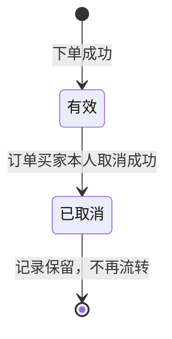
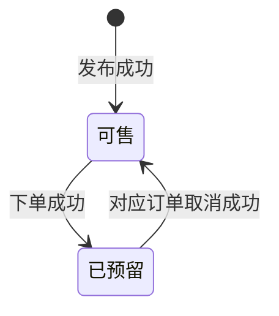
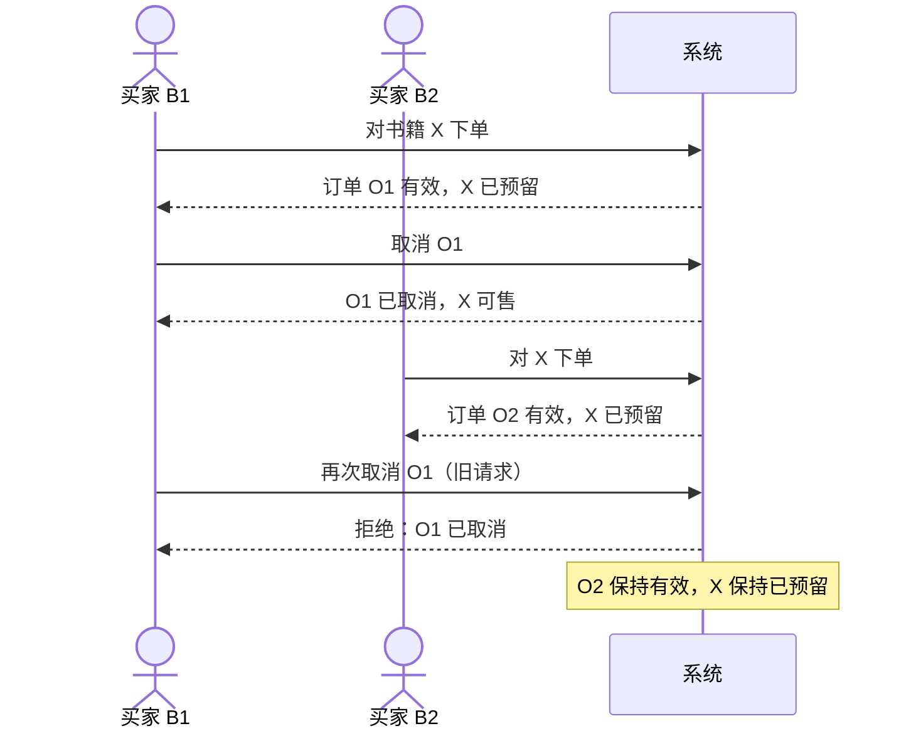

# 软件243班第21组 实验一 · 取消订单与NFR分析（讨论稿）

> **文档信息**
>
> | 项目 | 内容 |
> | --- | --- |
> | 课程 | 软件工程导论 |
> | 班级 / 小组 | 软件243班 / 第21组 |
> | 项目 | 校园二手书交易平台 |
> | 对应需求 | FR-07、FR-08 |
> | 对应用例 | UC-05 取消订单 |
> | 编写 | 成员 C |
> | 版本 | v0.1（讨论稿；2026-10-29 补充教师材料 v1.4 核对） |
> | 日期 | 2026-10-29 |
> | 状态 | 待全组评审；NFR 阈值均为小组候选值，未执行测试 |
> | 建议仓库路径 | `requirements/取消订单与NFR分析_v0.1.md` |

> **声明**
>
> 1. 本稿是成员 C 的课程作业讨论稿，不是组内已经通过的结论。
> 2. 文中“成员 C 意见”“建议”均待全组评审；本稿没有虚构组员讨论、测试结果或已完成的协作记录。
> 3. 所有 NFR 数字都是**小组候选值**，没有教师依据，也没有经过实测；不得写成“已经满足”或“测试通过”。
> 4. 2026-10-29 已对照《第1次课学生材料 v1.4》核对 `B-01～B-06`、`S-01～S-06` 及提交要求；教师材料原文在本地课程包中，仓库未附，引用仍以课堂材料为准。
> 5. 第一次课只要求需求初稿和完整用例图；第 5 节的 UC-05 详细描述是提前草拟，供第二次课定稿，不表示第一次课必须提交 3 个详细用例。

---

## 0. 结论摘要

1. **取消的对象是订单，不是书籍。** 取消请求必须能唯一确定一条订单；不能把“取消这本书的当前订单”当作取消语义，否则场景三的旧请求会误伤新订单。
2. **只有订单买家本人可以取消。** 其他买家、非该订单买家的卖家、未登录用户都不能取消；如果卖家本人就是该订单买家，则按买家本人处理；R-04 只是候选规则，暂按禁止自购讨论，需先确认；本课程范围没有定义管理员代取消。
3. **正常取消后的终态：** 订单由“有效”变为“已取消”，记录保留；关联书籍由“已预留”变为“可售”；其他买家可以重新下单。
4. **重复取消、越权取消、旧订单取消都应被拒绝。** “拒绝”指不执行取消、不改变订单/书籍/历史状态，并返回可理解的原因；这不等于一定要返回某个 HTTP 状态码。
5. **旧请求不能影响新订单，靠的是“订单身份 + 状态前置条件”。** 旧订单 O1 已经是终态“已取消”，再次取消 O1 只能失败；新订单 O2 是另一条记录，旧请求没有指向 O2，也不应被解释为“取消这本书现在的订单”。
6. **历史订单只增不删。** 取消是状态变化，不是删除；至少保留订单标识、书籍标识、买家、状态、创建/取消时间、操作者。
7. **NFR 与业务规则分开写。** “一本书最多一条有效订单”是业务不变量，不再单独算作 NFR；NFR 关注的是性能、失败原子性、易用性、可追溯性和持久性等质量要求。
8. **教师材料 v1.4 已核对。** `B-01～B-06`、`S-01～S-06` 与小组引用一致；第一次课只要求需求初稿和完整用例图，UC-05 的详细描述供第二次课定稿。与本稿配套的提交检查和 AI 记录模板见第 13 节、附录 C。

---

## 1. 分析范围、依据与方法

### 1.1 范围内

- 取消有效订单（FR-07）。
- 拒绝越权取消、重复取消、旧订单取消请求（FR-08）。
- UC-05 取消订单的正常流与异常流。
- 与取消订单直接相关的非功能需求候选。
- 对小组候选规则 R-01～R-05 的评审意见。
- 待确认业务规则与问题清单。

### 1.2 范围外

按教师约定，本阶段不涉及：

- 注册、找回密码；
- 真实支付、退款、物流、交易完成；
- 评价、推荐；
- 管理员后台、卖家下架/删除书籍等未被教师材料明确要求的功能；
- 数据库表结构、锁、类方法、接口协议等设计/实现细节。

> 本稿只描述“业务上应发生什么”和“如何客观检查”，不提前规定实现方式。文中出现的“按订单标识定位”“条件更新”等说法是需求层的约束说明，不是要求采用某种数据库或框架。

### 1.3 依据

| 编号 | 依据 | 本稿使用方式 |
| --- | --- | --- |
| B-01～B-06 | 教师材料 v1.4 的基本业务约定（已核对） | 取消订单主要引用 B-05；B-02/B-03/B-04/B-06 用于边界、角色和排除范围 |
| S-01～S-06 | 教师材料 v1.4 的讨论场景卡（已核对） | S-05 对应场景三，S-06 对应场景二 |
| R-01～R-05 | 第21组候选补充规则 | 仅组长初步同意，尚未全组评审；本稿逐条提意见 |
| FR-07、FR-08 | 小组 `requirements.md` v0.1 | 本稿分析并给出修订建议 |
| UC-05 | 小组用例图 v0.1 | 本稿补充用例描述与异常流 |
| 任务单/指导书 | 教师材料 v1.4 的 01、02 文件 | 用于第 13 节的课程要求对照与提交前检查 |
| 项目起始模板 | 教师材料 v1.4 的 06 文件 | 仅用于目录、README、AI 记录格式对照；模板中的 UC-04 是示例，不是本组编号 |

### 1.4 分析方法（五步）

1. **定边界**：先确认哪些行为在本次实验内，哪些不写，避免把支付、物流等后续业务混进取消流程。
2. **定对象**：把“用户、书籍发布记录、订单、历史订单、取消请求”分开；特别区分“订单标识”和“书籍标识”。
3. **定权限**：用账号身份判断“是不是订单买家”，而不是用“当前页面角色”或“是不是卖家”判断。
4. **走场景**：每个场景都写清前置条件、触发、正常结果、异常结果、终态和不变量；场景三要按时间顺序走一遍。
5. **提质量**：把业务规则和质量要求分开；NFR 必须能通过观察、测量或抽样检查，阈值标明“候选/待确认”。

### 1.5 成员 C 负责范围（个人说明）

> 这一段用于回答课程要求的“本人负责模块/子系统的名称、功能范围、输入输出、与其他部分的关系、本人具体工作”。它是个人说明，不是组内分工决议；3 人组中 D 的检索/追踪工作由谁分摊，仍需组会确认。

| 项目 | 内容 |
| --- | --- |
| 功能范围 | 取消订单（FR-07）、拒绝越权/重复/旧请求（FR-08）、UC-05 取消订单、取消异常场景、NFR 整理、待确认规则汇总 |
| 输入 | 教师材料 v1.4 的 `B-01～B-06`、`S-01～S-06`；小组 `requirements.md` v0.1；用例图 v0.1；`R-01～R-05` 候选规则 |
| 输出 | 本稿；FR-07/FR-08 修订建议；UC-05 描述；三场景与并发变体；NFR-01～NFR-05 候选；R-01～R-05 评审意见；Q-01～Q-16 |
| 与其他部分的关系 | 依赖 A 的发布记录（书籍来源）和 B 的下单（订单创建、有效订单）；取消结果影响书籍“可售/已预留”状态和检索展示；3 人组中检索/追踪由谁分摊待组会确认 |
| 本次实际分析/修改及证据位置 | 本稿第 3～9 节、第 13 节；未修改小组原始 `requirements.md`，未执行测试，未进行组内评审 |
| 尚未承担 | 发布、检索、下单的详细需求；完整用例图绘制；个人报告模板填写；GitHub Issue/Projects 操作 |

---

## 2. 术语、角色与状态

### 2.1 术语表

| 术语 | 本稿定义 | 说明 |
| --- | --- | --- |
| 预置测试账号 | 教师提供的、事先存在的账号 | 不涉及注册和找回密码 |
| 买家 / 卖家 | 业务角色，不是两个独立账号 | 同一账号可以同时承担买家和卖家角色 |
| 书籍发布记录 | 一条代表一本实物书的记录 | 不是“书目”或“ISBN 条目” |
| 可售 | 书籍当前没有被有效订单占用 | 可以被买家下单 |
| 已预留 | 书籍当前被一条有效订单占用 | 不能再被其他买家下单 |
| 订单 | 一次下单预留产生的记录 | 不代表付款，不代表交易完成 |
| 有效订单 | 状态为“有效”、仍占用对应书籍的订单 | 本书同一时刻最多一条 |
| 已取消订单 | 曾经有效、后被买家本人取消的订单 | 业务上也称“失效”；记录保留 |
| 历史订单 | 已取消订单及其记录 | 不物理删除，供查询/追溯 |
| 取消请求 | 用户针对某一条订单发起的取消操作 | 必须能唯一确定订单 |
| 拒绝 | 不执行取消，返回原因，不改变业务状态 | 与“系统错误”不同 |

### 2.2 角色与取消权限

| 角色 | 能否取消当前订单 | 说明 |
| --- | --- | --- |
| 订单买家本人 | 能 | 以账号身份与订单买家一致为准 |
| 其他买家 | 不能 | 越权；即使知道订单号也不能取消 |
| 卖家（非该订单买家） | 不能 | 教师约定只有订单买家本人可以取消；卖家下架/取消不在本实验范围 |
| 同一账号兼任卖家与买家 | 视订单归属而定 | 若其本人就是该订单买家，按“买家本人”处理；但 R-04 暂定禁止自购，需先确认 |
| 未登录 / 会话失效 | 不能 | 拒绝并提示登录；不得泄露订单信息 |
| 管理员 | 本实验未定义 | 如教师要求管理员代取消，需另行补充规则，不能默认存在 |

> **结论：** 取消权限的判断依据是“当前账号是否为该订单的买家”，不是“当前页面是买家视图还是卖家视图”，也不是“是否知道订单号”。

### 2.3 状态与状态机

**订单状态：**

**书籍状态：**

| 当前状态 | 事件 | 允许？ | 结果 |
| --- | --- | --- | --- |
| 订单：有效 | 买家本人取消 | 是 | 订单→已取消；书籍→可售；历史保留 |
| 订单：有效 | 非买家取消 | 否 | 拒绝；订单、书籍不变 |
| 订单：已取消 | 任何人再次取消 | 否 | 拒绝；订单、书籍不变 |
| 订单：不存在 | 取消 | 否 | 拒绝；不产生记录变更 |
| 书籍：可售 | 取消（无有效订单） | 否 | 拒绝；不存在可取消的有效订单 |
| 书籍：已预留 | 对应订单买家取消 | 是 | 书籍→可售 |
| 书籍：已预留 | 其他订单/其他人取消 | 否 | 拒绝；书籍保持已预留 |

### 2.4 业务不变量

以下是不变量，不是 NFR；它们用于判断每个场景的终态是否正确。

- **I1**：同一本书同一时刻至多存在一条有效订单。
- **I2**：若一条订单有效，则其关联书籍状态为“已预留”，且没有被其他有效订单占用。
- **I3**：已取消订单不被物理删除；历史可查询。
- **I4**：订单状态只能从“有效”转为“已取消”，不能从“已取消”恢复为“有效”。
- **I5**：取消请求只影响其明确指向的那一条订单，不按书籍“推断”当前订单。
- **I6**：取消不产生支付、退款、物流或交易完成记录。

---

## 3. FR-07 分析与修订建议

### 3.1 现有表述

> **FR-07**：有效订单的买家本人可以取消订单；取消后该订单失效、历史记录保留，关联书籍恢复“可售”。

### 3.2 逐项分析

| 现有要素 | 分析 | 需要补什么 |
| --- | --- | --- |
| “有效订单” | 方向正确，但没有定义“有效”的起止 | 明确：下单成功即为有效；取消成功即终止；本实验不设支付/完成状态 |
| “买家本人” | 需要可检查的身份判断 | 明确按账号 ID 与订单买家一致判断，不按角色页面判断 |
| “可以取消” | 没有说明取消的对象 | **必须写明取消的是“订单”，请求要能唯一确定订单** |
| “订单失效” | “失效”与“已取消”混用 | 统一术语：状态用“已取消”，业务含义可写“失效” |
| “历史记录保留” | 正确，但没写保留什么 | 至少保留订单标识、书籍标识、买家、状态、创建/取消时间、操作者 |
| “书籍恢复可售” | 正确，但没写前提 | 仅当该订单确实是书籍当前有效订单，且没有其他有效订单时，才恢复可售 |
| 取消原因 | 教师材料未要求 | 暂不作为必填；是否填写原因列为待确认 |
| 取消后的再次下单 | 未写 | 建议明确：取消成功后，其他买家可以重新下单；原买家是否可立即再下单待确认 |
| 通知卖家 | 未写 | 本实验不涉及通知；不要默认增加 |

### 3.3 修订建议（供全组讨论）

> **FR-07（修订建议 v0.2）**
>
> 订单买家本人可对一条仍为“有效”状态的订单发起取消。系统应以订单标识定位订单，校验：①操作者账号为该订单买家；②订单当前状态为“有效”；③订单关联书籍当前由该订单预留。校验通过后，系统将订单状态改为“已取消”，记录取消时间与操作者，保留该订单及其历史记录，并将关联书籍状态改为“可售”。取消不涉及支付、退款、物流或交易完成。取消成功后，其他买家可对该书重新下单；同一本书同一时刻仍至多一条有效订单。

**为什么这样改：**

- 把“取消对象”写清楚，直接支撑场景三。
- 把“身份、状态、书籍预留关系”写成三个校验条件，便于验收。
- 把“历史保留”具体化为可检查的记录字段。
- 不引入“取消原因”“通知卖家”等教师未要求的规则。

### 3.4 FR-07 验收要点

| 编号 | 给定条件 | 执行操作 | 预期结果 |
| --- | --- | --- | --- |
| AC-07-1 | 买家 B 有一条有效订单 O，书籍 X 为“已预留” | B 取消 O | O 变为“已取消”；X 变为“可售”；O 仍可查询 |
| AC-07-2 | 同上 | B 取消 O 后，买家 C 对 X 下单 | C 成功创建新有效订单 O2；X 变为“已预留” |
| AC-07-3 | 同上 | 取消后查看历史订单 | O 仍在历史中，状态为“已取消”，取消时间/操作者可见 |
| AC-07-4 | 同上 | 取消后检查支付/退款/物流记录 | 不产生任何支付、退款、物流或交易完成记录 |
| AC-07-5 | 订单 O 已取消 | 再次取消 O | 拒绝；O 仍为“已取消”；X 状态不被旧请求改变 |

> 以上是拟定验收方法，不是已经执行的测试结果。

---

## 4. FR-08 分析与修订建议

### 4.1 现有表述

> **FR-08**：非订单买家、已取消订单的旧请求不能改变当前有效订单和书籍状态；重复取消或越权取消应被拒绝并说明原因。

### 4.2 拒绝矩阵

| 请求者 | 订单状态 | 是否为该订单买家 | 结果 | 业务状态变化 |
| --- | --- | --- | --- | --- |
| 买家本人 | 有效 | 是 | 允许取消 | 订单→已取消；书籍→可售 |
| 买家本人 | 已取消 | 是 | 拒绝（重复取消） | 无 |
| 其他买家 | 有效 | 否 | 拒绝（越权） | 无 |
| 其他买家 | 已取消 | 否 | 拒绝（越权/旧请求） | 无 |
| 卖家（非买家） | 有效/已取消 | 否 | 拒绝（越权） | 无 |
| 任何人 | 不存在 | — | 拒绝（订单不存在） | 无 |
| 任何人 | 无法唯一确定订单 | — | 拒绝（请求不合法） | 无 |

### 4.3 逐项分析

1. **“非订单买家”**：要覆盖其他买家、卖家（非该订单买家）、未登录用户。判断依据是账号，不是页面角色。
2. **“已取消订单的旧请求”**：旧请求的目标是旧订单 O1；O1 已经是终态，不能再取消。它不能因为“同一本书”而被解释为取消新订单 O2。
3. **“重复取消”**：同一买家对同一条已取消订单再次取消。建议拒绝并提示“该订单已取消”，而不是再次执行取消。
4. **“越权取消”**：非买家取消。建议拒绝；提示语是否区分“无权”与“订单不存在”需要小组确认，避免泄露订单是否存在。
5. **“说明原因”**：原因应是用户能理解的自然语言，不是内部错误码或数据库术语；至少能区分“无权”“已取消”“订单不存在/已失效”。
6. **并发**：取消与下单、取消与取消同时发生时，最多一个请求完成状态转换；失败请求不能留下“半取消”状态。
7. **请求标识**：如果请求只带书籍 ID、不带订单 ID，系统无法知道要取消哪一条订单；应拒绝，不能猜测“当前有效订单”。

### 4.4 修订建议（供全组讨论）

> **FR-08（修订建议 v0.2）**
>
> 系统应拒绝下列取消请求，并保证订单、书籍和历史记录不发生改变：①操作者不是该订单买家；②订单标识不存在、非法或不足以唯一确定订单；③订单已处于“已取消”状态（重复取消）；④旧订单已取消后，其取消请求在书籍被新订单预留后再次到达；⑤取消与下单或其他取消并发，请求未能在订单仍有效时完成状态转换。拒绝时应返回可理解的原因，不得删除历史、不得把当前有效订单置为取消、不得把已被新订单预留的书籍改为“可售”。

**说明：**

- “拒绝”是业务结果，不等于必须使用某个 HTTP 状态码；具体响应格式属于设计阶段。
- 第⑤条不规定锁或事务实现，只要求“失败请求不产生部分修改”。
- 对越权请求，反馈不应泄露不必要的订单/个人信息；具体文案待确认。

### 4.5 旧请求为什么不能影响新的有效订单

这是场景三的核心，建议全组统一理解：

1. **请求指向的是订单记录，不是书籍。** 旧取消请求携带的是 O1 的订单标识；O1 已经“已取消”，再次取消只能失败。
2. **新订单是另一条记录。** O2 有新的订单标识、新的买家、新的创建时间；旧请求没有指向 O2，系统也不应把“取消 O1”翻译成“取消 X 的当前订单”。
3. **状态前置条件阻止二次流转。** 取消成功的前提是“订单仍为有效”；O1 不满足，因此不会再次修改 O1，更不会修改 O2。
4. **并发时也不例外。** O2 的创建前提是 O1 已取消、X 已恢复可售。如果 O1 取消与 O2 创建同时到达，系统应串行化处理：若 O1 取消先完成，则 X 可售，O2 可以创建；若 O2 创建先被处理而 O1 仍有效，则 O2 应被拒绝，直到 O1 取消成功后才能重试。无论哪种顺序，针对 O1 的取消请求都只能作用于 O1，不能让 O2 变成已取消，也不能把 X 从 O2 的预留中释放。
5. **如果请求只带书籍 ID，结论是“拒绝”。** 因为无法唯一确定订单；不能猜测“当前有效订单”并取消它。

### 4.6 FR-08 验收要点

| 编号 | 给定条件 | 执行操作 | 预期结果 |
| --- | --- | --- | --- |
| AC-08-1 | 买家 B 的有效订单 O，买家 C 已登录 | C 取消 O | 拒绝；O 仍有效；书籍仍“已预留” |
| AC-08-2 | 买家 B 的订单 O 已取消 | B 再次取消 O | 拒绝；O 仍“已取消”；书籍状态不变 |
| AC-08-3 | O1 已取消，B2 已创建新订单 O2，书籍 X 已预留 | 发送针对 O1 的旧取消请求 | 拒绝；O2 仍有效；X 仍“已预留” |
| AC-08-4 | 不存在订单号 | 取消 | 拒绝；不产生状态变化 |
| AC-08-5 | 请求只带书籍 X，不带订单标识 | 取消 | 拒绝；不猜测当前订单 |
| AC-08-6 | 同一订单 O 收到两个并发取消请求 | 同时执行 | 最多一个成功；O 最终“已取消”；无重复业务记录/无半取消状态 |
| AC-08-7 | O1 取消与 O2 创建并发 | 同时执行 | 若 O1 取消先完成，O2 可成功；若 O2 先处理而 O1 仍有效，O2 被拒绝；O2 不受 O1 旧请求影响；I1～I5 仍成立 |

> 以上是拟定验收方法，不是已经执行的测试结果。

---

## 5. UC-05 取消订单用例描述

> **说明：** 第一次课只要求需求初稿和完整用例图；本节是 UC-05 的**提前草拟**，供第二次课按课程字段定稿，不表示第一次课必须提交 3 个详细用例。第二次课仍需补齐/核对全部字段和至少 2 个有业务意义的异常或备选场景。

### 5.1 基本信息

| 项目 | 内容 |
| --- | --- |
| 用例编号 | UC-05 |
| 用例名称 | 取消订单 |
| 目标 | 买家取消自己仍有效的订单，释放书籍，同时保留历史 |
| 主要参与者 | 订单买家本人 |
| 异常参与者 | 其他已登录用户（越权/旧请求） |
| 触发条件 | 买家在订单或书籍页面选择“取消订单” |
| 前置条件 | 使用预置测试账号登录；订单存在；操作者是订单买家；订单状态为“有效”；关联书籍为“已预留” |
| 成功后置条件 | 订单“已取消”；历史保留；书籍“可售”；记录取消时间/操作者 |
| 失败后保证 | 订单、书籍、历史均不变；返回原因 |
| 关联需求 | FR-07、FR-08；B-05；S-05、S-06 |
| 验收条件 | 见第 3.4 节 AC-07-1～AC-07-5、第 4.6 节 AC-08-1～AC-08-7 |

### 5.2 主成功流

1. 系统显示订单及关联书籍摘要，并提供取消入口。
2. 买家发起取消。
3. 系统读取订单标识，校验登录态、买家身份、订单状态和书籍预留关系。
4. 校验通过，系统将订单状态改为“已取消”，记录取消时间和操作者。
5. 系统将关联书籍状态改为“可售”（仅在无其他有效订单时）。
6. 系统保留订单历史，更新订单列表/详情。
7. 系统提示取消成功，并显示书籍当前状态。
8. 用例结束。

### 5.3 异常流

| 编号 | 触发条件 | 系统响应 | 状态变化 |
| --- | --- | --- | --- |
| A1 | 未登录/会话失效 | 拒绝，提示登录 | 无 |
| A2 | 订单不存在/标识非法 | 拒绝，提示订单不存在或请求不合法 | 无 |
| A3 | 操作者不是订单买家 | 拒绝，提示无权取消（文案待定） | 无 |
| A4 | 订单已取消（重复取消） | 拒绝，提示该订单已取消 | 无 |
| A5 | 旧订单 O1 已取消，书籍已被 O2 预留，O1 的取消请求再次到达 | 拒绝，说明 O1 已失效；明确 O2 不受影响 | 无 |
| A6 | 同一订单的多个取消请求并发；或取消与重新下单并发 | 同一订单最多一个取消成功；新订单只能在旧订单取消成功后创建；失败方收到原因且无部分更新 | 成功方按正常流；失败方无变化 |
| A7 | 书籍状态与订单不一致（数据异常） | 拒绝并记录，转人工/待确认；不擅自修改 | 无（待定） |

### 5.4 业务规则

- **BR-01**：只有订单买家本人可以取消。
- **BR-02**：取消请求必须唯一确定一条订单；不能按书籍推断当前订单。
- **BR-03**：只有“有效”订单可以取消；已取消订单不能再次取消。
- **BR-04**：同一本书同一时刻至多一条有效订单。
- **BR-05**：取消后订单历史保留，不物理删除。
- **BR-06**：取消不涉及支付、退款、物流、交易完成。

---

## 6. 场景分析

### 6.1 场景一：买家正常取消自己的有效订单

| 项目 | 内容 |
| --- | --- |
| 前置 | 买家 B 登录；B 拥有书籍 X 的有效订单 O；X 为“已预留” |
| 步骤 | B 打开订单 O → 选择取消 → 系统校验通过 → 系统执行取消 |
| 预期 | O 变为“已取消”；X 变为“可售”；O 历史保留；B 看到成功提示 |
| 不变量 | I1～I6 均成立 |
| 额外检查 | 不产生支付/退款/物流记录；其他订单不受影响 |

### 6.2 场景二：其他用户尝试取消不属于自己的订单（对应 S-06）

| 项目 | 内容 |
| --- | --- |
| 前置 | 买家 B 的有效订单 O；用户 C 已登录但不是 O 的买家 |
| 步骤 | C 尝试取消 O |
| 预期 | 拒绝；O 仍“有效”；X 仍“已预留”；C 看到无权/失败提示 |
| 不变量 | I1～I5 均成立 |
| 额外检查 | 拒绝后保持不变：O 的状态、X 的状态、O 的历史记录、其他订单；提示不应泄露不必要的订单信息 |

### 6.3 场景三：取消后重新下单，旧请求再次到达（对应 S-05）

| 时刻 | 操作 | 订单 O1 | 订单 O2 | 书籍 X | 说明 |
| --- | --- | --- | --- | --- | --- |
| t0 | B1 对 X 下单 | 有效 | — | 已预留 | 创建 O1 |
| t1 | B1 取消 O1 | 已取消 | — | 可售 | 正常取消 |
| t2 | B2 对 X 下单 | 已取消 | 有效 | 已预留 | 创建 O2 |
| t3 | 旧请求：再次取消 O1 | 已取消 | 有效 | 已预留 | 拒绝；O2 不受影响 |
| t4 | 查询历史 | 已取消 | 有效 | 已预留 | O1、O2 都可查 |

**关键检查点：**

- t3 的请求必须携带 O1 标识；如果只带 X 标识，应拒绝，不能猜测 O2。
- t3 不能把 X 改为“可售”，否则会破坏 O2 的预留。
- t3 不能把 O2 改为“已取消”。
- t4 的历史中，O1 和 O2 是两条独立记录，状态分别是“已取消”和“有效”。

### 6.4 并发变体

| 场景 | 并发操作 | 期望 |
| --- | --- | --- |
| C1 | 同一订单 O 的两个取消请求 | 最多一个成功；O 最终“已取消”；另一个拒绝；无重复业务记录 |
| C2 | B1 取消 O1 与 B2 创建 O2 同时到达 | 若 O1 取消先完成，则 O2 可成功；若 O2 先被处理而 O1 仍有效，则 O2 应被拒绝；最终要么 O2 有效且 X 已预留，要么 O2 不存在且 X 可售；旧请求不影响 O2 |
| C3 | 两个买家同时对同一本“可售”书下单 | 最多一个有效订单；另一个拒绝；I1 成立（属于 FR-06，但与取消后的重新下单相关） |

### 6.5 场景覆盖检查表

| 检查项 | 场景一 | 场景二 | 场景三 | 并发变体 |
| --- | --- | --- | --- | --- |
| 权限判断 | ✓ | ✓ | ✓ | ✓ |
| 订单状态变化 | ✓ | — | ✓ | ✓ |
| 书籍状态变化 | ✓ | — | ✓ | ✓ |
| 历史保留 | ✓ | — | ✓ | ✓ |
| 旧请求隔离 | — | — | ✓ | ✓ |
| 拒绝原因 | — | ✓ | ✓ | ✓ |

---

## 7. 非功能需求（NFR）候选

### 7.1 先说明：NFR 不是重复业务规则

“同一本书最多一个有效订单”“只有订单买家本人能取消”是**业务规则/不变量**，不单独算作 NFR。下面的 NFR 关注的是系统质量：

- 操作够不够快（性能）；
- 被拒绝/并发时会不会留下半截状态（可靠性/失败原子性）；
- 用户能不能看懂结果（易用性）；
- 事后能不能查（可追溯性）；
- 重启后数据还在不在（持久性）。

> 以下所有数字均为**小组候选值**，没有教师依据，也没有实测。全组确认前，不得写成“已达成”。

### 7.2 NFR 汇总

| 编号 | 质量属性 | 一句话需求 | 优先级 | 指标状态 |
| --- | --- | --- | --- | --- |
| NFR-01 | 性能效率 | 取消请求在约定负载下 P95 不超过 2 秒 | P1 | 小组候选值，待确认 |
| NFR-02 | 可靠性/失败原子性 | 被拒绝或失败的取消不产生部分修改 | P1 | 检查方法待确认 |
| NFR-03 | 易用性 | 用户能正确理解取消结果和失败原因 | P1 | 样本/阈值待确认 |
| NFR-04 | 可追溯性 | 每次取消尝试可查询，历史订单不丢失 | P1 | 字段/期限待确认 |
| NFR-05 | 数据持久性 | 重启后已取消状态和历史不丢失 | P2 | 课程环境是否要求待确认 |

### 7.3 NFR-01 取消操作响应时间

| 项目 | 内容 |
| --- | --- |
| 质量属性 | 性能效率 |
| 需求陈述 | 在小组约定的典型数据集和并发负载下，取消订单成功请求的端到端响应时间 P95 不超过 2 秒；系统错误率不超过 1%（不含预期的业务拒绝）。 |
| 来源/依据 | 校园二手书使用高峰的等待容忍度；成员 C 提出的候选；非教师给定 |
| 优先级 | P1 |
| 拟定验收方法 | 预置 1,000 本书、1,000 条订单、100 个测试账号；使用 20 个并发用户，每人执行 10 次“取消—重置”操作，共 200 次有效取消；记录每次端到端时间；预期 P95≤2 秒，系统错误≤1%；测试数据可重置，不污染演示数据。 |
| 仍需小组确认 | 20 还是 50 并发；2 秒还是 3 秒；测端到端还是仅服务端；是否包含页面渲染；1,000 条数据是否过大。 |

> 该指标是小组候选值，未经过教师确认，也未实测。

### 7.4 NFR-02 失败原子性与状态一致性

| 项目 | 内容 |
| --- | --- |
| 质量属性 | 可靠性 / 失败原子性 |
| 需求陈述 | 取消请求被拒绝或失败时，不得对订单状态、书籍状态或历史记录产生部分修改；在重复取消、越权取消、旧订单取消、取消与重新下单并发等组合场景中，状态不一致次数为 0。 |
| 来源/依据 | FR-07/FR-08、S-05/S-06；教师对历史订单保留和单有效订单的约束；成员 C 整理 |
| 优先级 | P1 |
| 拟定验收方法 | 编排 100 组场景（每组含前置数据、请求序列、预期终态）；执行后比对订单、书籍和历史记录；预期 100% 符合；重点检查“旧订单取消不影响新订单”。 |
| 仍需小组确认 | 100 组是否足够；是否允许随机生成；是否把“拒绝原因正确”也纳入；并发场景用多少线程/用户。 |

> 该 NFR 检验的是“失败时不留下半截状态”，不是把“一本书一条有效订单”这条业务规则换个名字重复一遍。

### 7.5 NFR-03 取消结果的易理解性

| 项目 | 内容 |
| --- | --- |
| 质量属性 | 易用性 |
| 需求陈述 | 首次使用的非开发用户应能在不阅读文档的情况下完成取消，并正确理解结果：5 名测试用户中至少 4 名能正确回答“订单是否已取消、书籍是否恢复可售、失败原因是什么”；失败提示应指出原因，且不清空用户当前订单上下文；界面不应把内部错误码或数据库术语作为唯一提示。 |
| 来源/依据 | 校园用户多为学生，非专业用户；取消涉及状态变化，反馈必须清楚；成员 C 提出 |
| 优先级 | P1 |
| 拟定验收方法 | 准备 3 个任务（正常取消、越权取消、旧订单取消）；每名用户独立操作；记录任务完成率、回答正确率、是否求助；预期至少 4/5 完成且回答正确；失败后检查提示是否说明原因、是否保留当前订单上下文；可邀请 1～2 名非本组学生，减少同组偏差。 |
| 仍需小组确认 | 5 人样本是否够；80% 阈值是否合适；是否录像；是否只用同组同学；提示文案由谁定。 |

> 5 人和 80% 均为小组候选值，未测试。

### 7.6 NFR-04 取消记录可追溯

| 项目 | 内容 |
| --- | --- |
| 质量属性 | 可追溯性 / 可审计性 |
| 需求陈述 | 每次取消尝试（成功或拒绝）都应产生可查询的记录，至少包含订单标识、操作者账号、请求时间、结果与原因；已取消订单的历史记录在取消后仍可查询，不得物理删除。抽取 20 条成功、20 条拒绝记录，字段完整率 100%，且与订单/书籍终态一致。 |
| 来源/依据 | 教师要求历史订单保留；校园交易纠纷/责任追踪的需要；成员 C 提出 |
| 优先级 | P1 |
| 拟定验收方法 | 预置数据，执行正常取消 20 次；再执行越权、重复、旧请求合计 20 次；查询记录；预期 20 条成功 + 20 条拒绝均有字段；抽样核对订单、书籍终态；历史订单仍可查。 |
| 仍需小组确认 | 拒绝记录是否也保留；保留期限；是否记录 IP/设备（建议不记录，减少隐私）；谁可以查询；是否保存书名/价格快照。 |

> “每次尝试都记录”是候选设计，需全组确认；如果只记录成功取消，NFR-04 的拒绝部分要删掉。

### 7.7 NFR-05 重启后的数据持久性

| 项目 | 内容 |
| --- | --- |
| 质量属性 | 可靠性 / 数据持久性 |
| 需求陈述 | 系统正常重启或进程异常中断后，已成功取消的订单状态、书籍可售状态及历史记录不丢失；连续 10 次重启/恢复检查中，数据一致率 100%。 |
| 来源/依据 | 课程演示需要可重复；避免“重启后订单又变有效”；成员 C 提出 |
| 优先级 | P2 |
| 拟定验收方法 | 准备 10 条订单，取消其中 5 条；重启服务/模拟中断；查询；预期 5 条已取消、5 条有效，书籍状态对应，历史完整；每轮恢复同一基线数据，重复 10 次。 |
| 仍需小组确认 | 课程环境是否使用持久化存储；是否要求“异常中断”；10 次是否过多；是否只做正常重启。 |

> 若本课程只做静态原型、不要求运行，NFR-05 可降为 P2 或移出本次范围。

### 7.8 指标待确认汇总

| NFR | 待确认指标 | 建议默认（仅候选） |
| --- | --- | --- |
| NFR-01 | 并发数、P95 阈值、数据集规模、端到端口径 | 20 并发、2 秒、1,000 条 |
| NFR-02 | 场景组数、是否随机、是否含原因正确性 | 100 组、编排场景、含终态 |
| NFR-03 | 用户数、正确率阈值、是否外部用户 | 5 人、4/5、可含 1～2 名外部 |
| NFR-04 | 拒绝是否记录、保留期限、查询权限 | 记录、课程期间、组内可查 |
| NFR-05 | 是否要求异常中断、重启次数 | 正常重启、10 次 |

### 7.9 建议的验证顺序

1. 先做 NFR-02（失败原子性）——它直接关系场景三是否正确。
2. 再做 NFR-04（可追溯）——确认历史订单和拒绝记录能查到。
3. 然后做 NFR-01（性能）——在功能正确的基础上测时间。
4. 再做 NFR-03（易用性）——需要可操作界面或可点击原型。
5. 最后做 NFR-05（持久性）——取决于课程是否要求运行环境。

---

## 8. 候选业务规则评审（R-01～R-05）

> 评审身份：成员 C。以下为个人意见，供全组讨论；不代表 B 或组长已经同意。

### 8.1 评审表

| 规则 | 现有表述 | 成员 C 意见 | 建议修订 | 建议优先级/状态 |
| --- | --- | --- | --- | --- |
| R-01 | 发布书籍时，书名、作者、价格、成色为必填项。 | 方向同意；但“必填”要能检查，价格还要有格式规则。 | 改为“书名、作者、价格、成色为必填；去除首尾空白后不得为空；价格须为数值；成色须为小组约定的枚举值（枚举待定）”。 | P1；待全组评审 |
| R-02 | 支持书名关键词检索，可按作者进一步筛选。 | 同意；但检索匹配方式、空关键词、组合条件没定义。 | 明确：书名关键词采用包含匹配；作者筛选为可选条件；两者同时使用时取交集；空关键词是否返回全部待确认；结果排序/分页待定。 | P1；待全组评审 |
| R-03 | 书籍价格必须大于 0。 | 同意“价格必须有效”的方向；但要明确数值类型、小数位、上限，以及是否允许 0 元赠送。 | 改为“价格必须是大于 0 的数值，最多两位小数，上限待定；非数值/0/负数拒绝”。若允许 0 元赠送，则改为“≥0”。 | P1；待全组评审 |
| R-04 | 不允许用户预留自己发布的书籍。 | 方向同意；仓库 v0.1 已使用“预留”，术语比“购买”准确，建议保留。教师材料只把“能否购买自己发布的书”列为待确认细节，并未规定禁止，因此这是小组候选规则，需确认是否纳入核心范围。 | 保留“同一账号不能对自己发布的书籍下单预留”；明确“自己”按账号判断；是否允许同一人用另一账号下单不在测试范围。 | 建议 P1，但标注“小组补充规则，待确认”；若教师不要求可降 P2 |
| R-05 | 检索结果至少显示书名、价格、成色、可售状态。 | 同意；但“可售状态”的取值、已预留书籍是否展示、无结果提示没定义。 | 明确状态显示为“可售/已预留”；已预留书籍是否出现在结果中待确认；无结果时给出明确提示；详情页其他字段另定。 | P1；待全组评审 |

### 8.2 逐条说明

**R-01（必填字段）**

- “必填”建议定义成可检查的规则：去掉首尾空格后非空，而不是“页面上有星号”。
- 价格同时受 R-01（必填）和 R-03（大于 0）约束，两条要一起测。
- 成色如果是下拉选择，需先确定枚举值；如果不是下拉，需定义合法值集合。
- 书名/作者的长度上限、是否允许特殊字符，可作为实现/设计阶段问题，不必现在写死。

**R-02（检索）**

- “书名关键词”建议明确为包含匹配；中文通常不涉及大小写，但英文书名要考虑是否忽略大小写。
- 作者筛选是精确匹配还是包含匹配？建议至少明确一种。
- 两个条件同时使用时，建议取交集（AND），而不是并集。
- 空关键词是否返回全部书籍，会影响结果数量与性能，需确认。
- 结果排序（发布时间/价格/相关度）未定义，可先不写，但验收时要固定测试数据。

**R-03（价格）**

- “大于 0”要明确是数值比较，不是字符串比较；要拒绝非数值、空白、NaN 等。
- 是否允许 0 元赠送是一个产品决策：如果校园里存在免费赠书，R-03 会把它挡掉；如果课程只要求“价格大于 0”，则保持现状。
- 上限和两位小数是候选，需全组确认；不要在没有依据时写成教师规定。

**R-04（自购限制）**

- 术语很重要：本系统没有真实支付，仓库 v0.1 已使用“预留”，建议保留；若其他材料写成“购买”，统一改为“下单预留”。
- “自己”按账号判断；同一账号可以同时是买家和卖家，但对自己发布的书籍下单应被拒绝。
- 教师材料原文只把“能否购买自己发布的书”列为待确认问题，并没有规定禁止；这条是小组候选规则，建议在组内确认是否纳入核心范围，避免答辩时被问“依据是什么”。
- 如果保留 R-04，FR-05/FR-06 的验收要覆盖“卖家本人下单被拒绝”；如果不保留，要删除相关验收，不能两头都写。

**R-05（检索结果字段）**

- “可售状态”至少要有“可售/已预留”两个值；是否显示“已取消”不适用于书籍。
- 已预留书籍是否出现在检索结果中，是产品选择：显示但标记“已预留”可以帮用户知道这本书存在；不显示则减少无效点击。两种都合理，但必须选一个。
- 无匹配结果时要有明确提示，不能空白页。
- 详情页是否显示卖家、发布时间、描述等，另列待确认，不要塞进 R-05。

### 8.3 跨规则问题

1. **术语统一**：“购买” vs “下单/预留”；“失效” vs “已取消”；“卖家/买家”是角色，不是账号。建议在 `requirements.md` 增加术语表。
2. **规则与 FR 的边界**：R-02、R-05 更像功能需求/展示规则，不完全是“业务规则”；保留在候选规则表也可以，但评审时要说明它们会落到 FR-03/FR-04。
3. **规则状态**：目前只有组长初步同意，不能写成“全组通过”。建议每条规则记录“同意/建议修改/待确认”和依据。
4. **不要新增教师未要求的规则**：如“取消必须填原因”“订单 24 小时自动取消”“卖家可下架”，除非全组明确决定并记录依据。

---

## 9. 待确认问题清单

> 优先级：P0 = 阻塞 FR/UC 定稿；P1 = 本次实验结束前应确认；P2 = 可延后或作为设计阶段问题。

| 编号 | 问题 | 为什么需要确认 | 当前暂定处理 | 优先级 |
| --- | --- | --- | --- | --- |
| Q-01 | 取消请求用订单 ID 还是书籍 ID 定位？ | 决定场景三能否成立；用书籍 ID 会误伤新订单 | 必须用订单 ID；无法唯一确定则拒绝 | P0 |
| Q-02 | 重复取消是“拒绝”还是“幂等返回成功”？ | 影响 FR-08 验收和用户提示 | 按现有 FR-08：拒绝，提示已取消 | P0 |
| Q-03 | 越权取消的提示是否区分“无权”和“订单不存在”？ | 涉及安全/隐私与易用性平衡 | 暂用不泄露细节的提示；待定 | P1 |
| Q-04 | 卖家能否取消/下架自己发布的书籍？ | 教师只约定买家本人取消；若加卖家取消会扩大范围 | 本实验不加入；卖家非买家不能取消 | P0 |
| Q-05 | 取消是否必须填写原因？ | 影响字段、界面和验收 | 暂不作为必填；待定 | P2 |
| Q-06 | 订单是否有超时自动取消？ | 教师未提；若有，会改变“有效”定义 | 暂定没有自动取消 | P1 |
| Q-07 | 取消后原买家能否立即重新下单？ | 影响“恢复可售”后的业务规则 | 暂定可以，作为新订单；待确认 | P1 |
| Q-08 | 历史订单保留哪些字段、保留多久？ | 影响 NFR-04 和查询页面 | 至少订单/书籍/买家/状态/时间/操作者；期限待定 | P1 |
| Q-09 | 书籍被删除或卖家账号停用后，订单还能取消吗？ | 可能出现“订单有效但书籍不存在” | 暂定不在本实验范围；需明确 | P1 |
| Q-10 | 已预留书籍是否出现在检索结果中？ | 影响 R-05 和 UC-02/03 | 未定；两种方案都可，需选一个 | P1 |
| Q-11 | 是否允许 0 元赠书？ | 影响 R-03 的“大于 0” | 暂按 R-03 拒绝 0 元；待确认 | P2 |
| Q-12 | 预置测试账号有几个、分别承担什么角色？ | 验收场景需要至少两个买家账号 | 至少 2 个买家账号 + 卖家账号；具体待定 | P0 |
| Q-13 | NFR 的并发数、P95、用户样本等取多少？ | 没有教师依据，不能写成已测试 | 见第 7 章候选值；全组确认后写入 | P1 |
| Q-14 | “有效订单”是否只由取消结束？ | 若有支付/完成/超时，状态会更多 | 本实验只有“有效/已取消” | P0 |
| Q-15 | 取消是否需要二次确认/撤销？ | 影响易用性，但不影响业务终态 | 暂不作为必填；可作 UI 设计 | P2 |
| Q-16 | R-04（禁止自购）是否纳入核心范围？ | 教师材料只把它列为待确认细节；纳入会影响 FR-05/FR-06 验收和用例图 | 暂按纳入讨论，但标注“小组候选”；待全组确认 | P1 |

> 表中“当前暂定处理”是本稿为了继续分析而采用的假设，不是教师规定，也不是组内决议。
>
> **组会使用方式：** 请为每条补“状态（已约定/暂定/待确认）”和“负责人”。本稿不预填负责人，避免把建议当成决议；除 `B-01～B-06` 已由教师材料明确外，其余均按“待确认”处理。

---

## 10. 追踪矩阵

| 需求 | 用例 | 主要场景 | 相关 NFR | 相关规则 |
| --- | --- | --- | --- | --- |
| FR-07 取消有效订单 | UC-05 主成功流 | 场景一 | NFR-01、NFR-03、NFR-04、NFR-05 | B-05 |
| FR-08 拒绝越权/重复/旧请求 | UC-05 异常流 A2～A6 | 场景二、场景三、并发变体 | NFR-02、NFR-03、NFR-04 | B-05、S-06 |
| R-01 发布必填 | UC-01 | 不直接涉及取消 | NFR-04（历史字段） | 小组候选 |
| R-02 检索 | UC-02 | 不直接涉及取消 | NFR-01（若含检索性能） | 小组候选 |
| R-03 价格大于 0 | UC-01 | 不直接涉及取消 | — | 小组候选 |
| R-04 禁止自购 | UC-04 | 影响“卖家是否能成为买家” | NFR-02（权限边界） | 小组候选 |
| R-05 检索结果字段 | UC-02/03 | 影响取消后书籍状态展示 | NFR-03（可理解性） | 小组候选 |

---

## 11. 对现有 `requirements.md` 的修改清单

建议在小组现有 `requirements.md` 上做以下修改；是否采纳由全组决定。

- [ ] **FR-07**：用第 3.3 节修订文本替换现有表述，补“以订单标识定位”“校验订单状态与书籍预留关系”“记录取消时间/操作者”。
- [ ] **FR-08**：用第 4.4 节修订文本替换或拆分，补“订单标识不足”“并发失败原子性”“不得把新订单书籍改为可售”。
- [ ] **新增**：在 FR 表后增加“取消订单拒绝矩阵”（第 4.2 节）或链接到本稿。
- [ ] **新增**：增加 NFR 候选章节（第 7 章），至少保留 NFR-01～NFR-04；NFR-05 可标 P2。
- [ ] **新增**：增加术语表（第 2.1 节），统一“下单/预留”“已取消/失效”“订单/书籍”。
- [ ] **修改 R-04**：把“购买”改为“下单预留”，并标注“小组补充规则，待确认是否纳入核心范围”。
- [ ] **修改 R-01/R-03**：补“去除首尾空白后非空”“价格为数值、最多两位小数、上限待定”。
- [ ] **修改 R-02/R-05**：补“包含匹配/交集/空关键词/已预留是否展示/无结果提示”的待确认项。
- [ ] **新增**：待确认问题清单（第 9 章）或链接到本稿。
- [ ] **状态**：保留“组长初步同意、待全组评审”，不要改成“已通过”。
- [ ] **AI 使用记录**：按小组现有约定，在 `records/ai-use.md` 或等效文档记录本稿的 AI 辅助情况、人工核验和后续修改；不要补造未发生的讨论。

---

## 12. 建议的全组评审步骤

以下只是建议议程，不是已经发生的会议记录。

1. **10 分钟：术语与边界**——确认“订单/书籍”“有效/已取消”“买家本人”的定义；确认卖家不能取消。
2. **15 分钟：FR-07/FR-08**——逐条读修订文本，重点确认“取消对象是订单”“重复取消是拒绝”。
3. **15 分钟：场景三**——按第 6.3 节时间线走一遍；再讨论并发变体；确认旧请求不碰新订单。
4. **10 分钟：NFR**——先定 NFR-02 的检查方法，再定 NFR-01 的并发/阈值；明确所有数字是候选值。
5. **10 分钟：R-01～R-05**——逐条给出“同意/建议修改/待确认”，记录依据；R-04 重点确认是否纳入核心范围。
6. **10 分钟：分工与记录**——谁改 `requirements.md`、谁补用例图、谁记录 AI 使用；下次检查前完成。

**评审后的最低交付：**

- FR-07/FR-08 修订文本进入 `requirements.md`；
- 三条以上 NFR 有编号、来源、优先级、验收方法、待确认指标；
- R-01～R-05 有明确状态（不能只写“组长同意”）；
- Q-01～Q-16 中 P0 项有结论；
- 不在文档中写“已测试/已通过”，除非真的执行并留下记录。

---

## 13. 与教师材料 v1.4 的对照与补充

### 13.1 课程要求对照

| 课程要求 | 本稿对应位置 | 当前状态 |
| --- | --- | --- |
| 系统概述、业务背景、范围 | 第 1、2 节；完整概述由小组在 `requirements.md` / `scope.md` 统一 | 本稿只覆盖取消相关，不能替代小组系统概述 |
| 本人负责模块说明 | 第 1.5 节 | 已写功能范围、输入输出、关系、证据位置、尚未承担 |
| 6—10 条功能需求 | 小组 `requirements.md` 已有 FR-01～FR-08 | 本稿只修订 FR-07/FR-08，不重复列全部 FR |
| 至少 3 条可检查 NFR | 第 7 节 NFR-01～NFR-05 | 5 条候选，均有验收方法；阈值待组会确认 |
| 完整用例图 | 小组 `requirements/软件243_21组_实验一_完整用例图_v0.1.drawio` / `.png` | 本稿只核对 UC-05，不替代完整用例图 |
| 3 个详细用例 | 第 5 节只有 UC-05 | 第一次课不要求；第二次课再补齐发布、下单、取消 3 个 |
| 验收条件“给定—操作—预期” | 第 3.4、4.6 节 | 已按三列改写；仍为拟定检查方法，未执行 |
| 评审与修订记录 | 第 12 节；Q-01～Q-16 | 第 12 节只是建议议程，不是已发生会议记录 |
| 大模型使用记录 | 附录 C | 提供模板和本次实际交互；采用判断、人工核验待本人填写 |
| GitHub / 提交包 | 第 13.3 节 | 待按清单实际操作；本稿未提交、未推送 |

### 13.2 用例图与编号提醒

1. **先统一 UC 编号。** 小组现有材料把“取消订单”写成 **UC-05**；教师项目起始模板的 `use-cases.md` 示例把“取消订单”写成 **UC-04**。两者只能保留一个。建议全组确认后，同步修改 `requirements.md`、`use-cases.md`、用例图、个人报告、Issue 和本稿；不要在不同文件里并存两个编号。
2. **UC-05 只连“买家”。** 卖家不是取消订单的主要参与者；卖家若同时是订单买家，按“买家本人”处理。用例图中不要给卖家再连一条“取消订单”。
3. **越权取消、重复取消、旧请求取消是 UC-05 的异常/备选流，不单独画成用例。** 否则会把“校验步骤”误当成用户目标，和教师“不要为复杂度拆用例”的要求冲突。
4. **“先下单、后取消”是时间顺序，不是用例关系。** 不要为了表达先后而加 `<<include>>` / `<<extend>>` 连线；在用例描述和场景表里写清前置条件即可。
5. **源文件与导出图必须同版本。** 修改 `.drawio` 后重新导出 PNG/PDF，文件名和版本号保持一致；个人报告引用同一版本。
6. **参与者名称统一。** 用“买家”“卖家”“预置测试账号”，不要混用“用户/学生/卖家/买家”造成角色歧义；同一账号可承担两种角色，但每次操作的身份要明确。

### 13.3 提交前检查清单

> 以下是对照教师材料整理的检查项，不代表已经完成。逐项打勾前，请先确认证据真实存在。

**A. 仓库与 README**

- [ ] `README.md` 写明项目背景、范围、组号（第21组）、成员账号及分工、文档入口、Projects 看板链接、各阶段提交记录。
- [ ] 仓库至少含 `README.md`、`requirements/`、`database/`、`design/`、`records/`；没有内容的目录用 README 说明“后续实验补充”，不要放空占位冒充成果。
- [ ] 对照项目起始模板，按组内决定补齐 `requirements/README.md`、`scope.md`、`use-cases.md`；不要为了凑文件复制同一内容。
- [ ] 若尚未建立 `records/ai-use.md`，按模板建立；只记录真实发生的 2—3 次关键交互，不补造。

**B. Issue 与 Projects**

- [ ] 为“取消订单异常场景”建立/认领真实 Issue，写清负责人、完成条件、所属实验；完成条件可写“明确越权取消、重复取消、旧请求取消的结果，并同步 UC-05 与 FR-08 说明”。
- [ ] Issue 加入 Projects，状态使用 Todo / In Progress / Done；开始和完成时真实更新，不伪造历史。
- [ ] 提交说明引用 Issue 编号；完成后在 Issue 中附成果路径、提交链接和检查结论。

**C. 文档与报告**

- [ ] 第 03 工作表填写：班级、组号、日期、项目、组长、建模工具及版本、仓库链接、Projects 链接、成员访问、分工与贡献入口、成果入口、自查与修订、大模型使用、commit SHA、阶段包、下次 3 个用例主责人。
- [ ] 第 04 报告模板保留首页及“实验目的、实验器材、实验内容”栏目；成绩栏留空，个人信息按实际填写。
- [ ] 个人报告能独立阅读，不以“详见组员报告”替代；本人能回答“我的主责内容在哪里、这条需求依据是什么、哪项规则尚未确认”。
- [ ] 本稿中的 NFR 数字仍标“候选/待确认”；没有实测就不要写“已测试/已通过”。

**D. 提交包与版本**

- [ ] 阶段包建议命名 `软件243_21_实验一_第1次课_v0.1.zip`；最终包按课堂通知命名。
- [ ] 包含：精简工作表与成果附件、需求简表、完整用例图源文件 + PNG/PDF、检查及过程记录、GitHub 阶段记录、下次任务清单。
- [ ] 记录完整 commit SHA、本人 Issue/贡献链接；SHA 必须来自真实提交，不能先写占位符再当证据。
- [ ] 第一次课不要求 3 个详细用例；不要把本稿的 UC-05 草稿说成“三个用例已完成”。

**E. 事实边界**

- [ ] 教师已明确的写“教师约定”；小组候选写“小组候选/待确认”；个人意见写“成员 C 意见”。
- [ ] 不写“已互评/已测试/已通过”，除非有真实记录。
- [ ] AI 使用记录不能代替个人报告、组间互评或人工核验。

### 13.4 仓库现状对照（2026-10-29 只读核查）

> 以下只根据 GitHub 仓库文件树和 README 原文核对，未修改仓库；Issue/Projects 不在文件树中，需登录后另行确认。

| 项目 | 当前情况 | 与本课程要求的差距 | 建议动作 |
| --- | --- | --- | --- |
| `README.md` | 只有一句“软件工程导论实验 - 软件243班第21组 - 校园二手书交易平台” | 缺项目背景、范围、组号、成员账号及分工、文档入口、看板链接、阶段提交记录 | 按第 13.3 节 A 补写；不要写未发生的提交记录 |
| `requirements/requirements.md` | 已有 FR-01～FR-08、UC-01～UC-05、R-01～R-05；状态为组长初步同意、待 B/C 确认 | 缺 NFR 汇总；FR-07/FR-08 尚未按本稿修订；R 规则仍为“暂定” | 组会确认后合并 FR-07/FR-08、NFR 和 R 状态；保留“待确认”标记 |
| `requirements/软件243_21组_实验一_完整用例图_v0.1.drawio` / `.png` | 源文件和导出图都在 | 需核对 UC-05 是否连买家、参与者/用例命名是否与正文一致；模板存在 UC-04 编号差异 | 全组统一 UC 编号；修改后重新导出 PNG/PDF |
| `records/` | 文件树中未见 | 缺评审、修订、AI 使用等过程记录 | 建立 `records/ai-use.md` 或按课堂要求命名；只记录真实过程 |
| `database/`、`design/` | 文件树中未见 | 课程要求仓库至少包含这些目录；可用 README 说明“后续实验补充” | 建立目录和 README，不放假成果 |
| Issues / Projects | 文件树中不可见 | 需确认是否已建真实任务、负责人、完成条件和看板状态 | 登录后按第 13.3 节 B 检查；没有就补建，不伪造历史 |
| 提交包 / commit SHA | 本次未提交、未推送；无 SHA | 还没有可引用的阶段版本 | 真实提交后再记录 SHA；不要把本稿日期当提交时间 |

---

## 附录 A 术语一致性建议

| 不建议 | 建议 | 原因 |
| --- | --- | --- |
| 购买 / 买书 | 下单 / 预留 | 本系统没有真实支付 |
| 订单失效 | 订单已取消（业务上失效） | 状态名统一，避免“失效”被理解成删除 |
| 删除订单 | 取消订单 / 保留历史 | 教师要求历史保留 |
| 卖家取消订单 | 买家本人取消订单 | 教师约定只有订单买家本人可以取消 |
| 书籍下架 | 不在本实验范围 | 教师未要求，避免扩大范围 |
| 当前订单 | 订单 O1 / O2（带标识） | 避免“按书籍推断订单”的歧义 |

## 附录 B 参考与工具说明

**参考：**

- 小组仓库 `requirements/requirements.md` v0.1（2026-10-27）。
- 小组仓库 `requirements/软件243_21组_实验一_完整用例图_v0.1.drawio` / `.png`。
- 教师材料 v1.4：`01_第1次课_任务单.pdf`、`02_实验一需求分析指导书.pdf`、`03_第1次课小组工作表.docx`、`04_实验报告模板.docx`、`05_GitHub项目管理操作说明.pdf`、`06_项目起始模板.zip`；本地课程包 `_course_material_lab1`，仓库未附。
- 教师约定 `B-01～B-06`、讨论场景 `S-01～S-06`（已对照 v1.4 原文核对）。

**工具说明：**

- 本文档使用 Markdown 编写；具体编辑器及版本由成员 C 在提交前补充，不要写未使用的工具。
- 文中的 Mermaid 状态图/时序图由支持 Mermaid 的 Markdown 渲染器显示；若课程要求导出图片，应另存 PNG/PDF 并注明渲染工具及版本。
- 小组用例图使用 draw.io 维护；draw.io 具体版本以源文件属性或组内记录为准，本稿不代为填写。
- 未使用数据库、接口测试或性能测试工具；本稿没有运行结果。

---

## 附录 C 大模型使用关键交互记录

> 按教师材料要求，整个实验选取 2—3 次**有实际影响**的关键交互记录；实际不足 2 次时如实记录，不凑数量。下表只记录已经发生的 AI 辅助，**采纳判断与人工核验必须由本人填写**，AI 不能代填。

| 序号 | 环节与材料版本 | 工具/模型、日期 | 关键问题/提示词 | 输出要点及保存位置 | 采纳决定与理由 | 人工修改及核验证据 | 负责人 |
| --- | --- | --- | --- | --- | --- | --- | --- |
| 1 | 需求分析初稿；教师材料 v1.4、小组 `requirements.md` v0.1 | DeepSeek Harness（deepseek-flash），2026-10-29 | 请求分析 FR-07/FR-08、取消订单正常/异常场景、至少 3 条可检查 NFR、R-01～R-05 评审和待确认问题；要求区分事实/假设，不编造组员讨论或测试结果 | 形成本稿主体（第 0～12 节）；保存于 `requirements/取消订单与NFR分析_v0.1.md` | 待本人判断（逐条选择采纳/修改后采纳/不采纳，并写理由） | 待本人核验（需逐条读、改，保留修改前后对照或截图） | 成员 C（待本人确认） |
| 2 | 教师材料核对；教师材料 v1.4 | DeepSeek Harness（deepseek-flash），2026-10-29 | 核对任务单/指导书中的 B-01～B-06、S-01～S-06、第一次课/第二次课边界、AI 记录与 GitHub 提交要求，指出本稿需要补充的内容 | 补充第 1.5、13 节和附录 B/C，修订验收表头、UC-05 字段、Q-16；保存位置同上 | 待本人判断（不要默认全部采纳） | 待本人核验（对照 PDF 原文逐项检查） | 成员 C（待本人确认） |
| 3 | 第 2 次课/后续实际交互（如有） | 待填 | 待填 | 待填 | 待填 | 待填 | 待填 |

**记录要求：**

- 若某条建议最终不采用，在“采纳决定与理由”写“不采纳”及原因；不要把 AI 输出全部写成“采纳”。
- 只使用教学情境和虚构数据；不向外部模型输入真实学生名单、账号密码或未经授权的材料。
- 保存关键输入输出或截图，能定位采用内容、人工修改和核验证据；自动生成的日志/测试结果不能代替实际执行证据。
- 原始对话在本次工具会话中；提交前由本人按课程要求导出或截图，放到 `records/` 或课堂指定位置。
- 如果最终没有使用大模型，填写“未使用”，不要补造交互记录。

---

## 版本记录

| 版本 | 日期 | 修改人 | 说明 |
| --- | --- | --- | --- |
| v0.1 | 2026-10-29 | 成员 C | 初稿：FR-07/FR-08 分析、UC-05、三场景、NFR 候选、R-01～R-05 评审、待确认问题 |
| v0.1-r2 | 2026-10-29 | 成员 C | 对照教师材料 v1.4：补成员 C 范围说明、验收表头、UC-05 字段、Q-16、第 13 节提交检查与仓库现状对照、附录 B 工具说明与附录 C AI 记录模板；按仓库原文校正 R-04 表述；未提交、未测试 |
